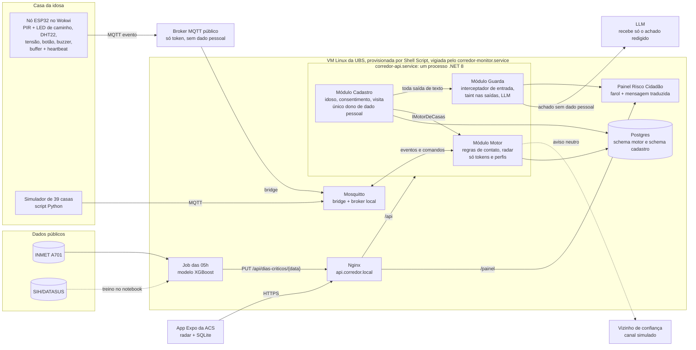

# Arquitetura técnica do Corredor Aceso

Este documento define as partes da solução, o dono de cada dado e os contratos entre as partes. Ele também mostra onde cada disciplina pontua. A ficha, as seis perguntas e a pergunta de ML continuam em [01-ideia-vencedora.md](discovery/01-ideia-vencedora.md).

Objetivo do protótipo: em dia crítico, o celular da ACS mostra só as casas que ficaram em silêncio. Um movimento no corredor do Wokwi tira o card da tela. Um aparelho mudo deixa o card cinza, nunca verde.

## Diagrama



## Quatro decisões que mudam o desenho da descoberta

1. **Um monólito modular em C#, não duas APIs.** O enunciado de SOA aceita qualquer linguagem. Uma solução .NET com três módulos cobre a rubrica de SOA e a de C# com um processo, um deploy e uma linguagem de backend. O contrato REST entre FastAPI e .NET some e vira uma interface C#. O que se perde é a separação por processo, e a regra 2 repõe essa separação por projeto.
2. **O módulo Motor não guarda dado pessoal.** O Motor conhece só `casaToken` e perfil. O projeto `Corredor.Motor` não referencia `Corredor.Cadastro`, então o compilador impede o Motor de ler um nome. O app junta token e nome no celular, com a lista de nomes que baixou para o SQLite.
3. **O `DiaCritico` entra direto no Motor.** O turno de radar é do Motor.
4. **O nó Wokwi publica em um broker público e o Mosquitto da VM faz bridge.** O Wokwi do navegador só alcança a rede local com o Private Gateway, que é pago ([documentação do Wokwi](https://docs.wokwi.com/guides/esp32-wifi)). O payload só tem token. O simulador das 39 casas publica direto no Mosquitto local.

## Partes e donos

| Parte | Pasta | Tecnologia | Dono de | Disciplina |
|---|---|---|---|---|
| Nó do corredor | `iot/` | ESP32, Wokwi, PubSubClient | leitura dos sensores, buffer, heartbeat | Physical Computing |
| Módulo Motor | `api/src/Corredor.Motor` | .NET 8, EF Core, MQTTnet | `CasaMonitorada`, `EventoSensor`, `DiaCritico`, `TurnoRadar`, estado do radar | C# |
| Módulo Cadastro | `api/src/Corredor.Cadastro` | .NET 8, EF Core | `Microarea`, `Idoso`, `Casa`, `Consentimento`, `VizinhoDeConfianca`, `Visita`, `MensagemSaida` | SOA |
| Módulo Guarda | `api/src/Corredor.Guarda` | .NET 8, regras em JSON, LLM por HTTP | regras de PII, rótulos, achados, painel | Cybersecurity |
| Host | `api/src/Corredor.Api` | ASP.NET Core, Swagger | rotas, injeção de dependência, autenticação | C# e SOA |
| Testes | `api/tests/` | xUnit | um projeto de teste por módulo | C# e SOA |
| Modelo de dia crítico | `ml/` | pandas, XGBoost, scikit-learn | notebook, relatório, `prever_hoje.py` | IA e ML |
| App da ACS | `app/` | Expo, React Native, TypeScript, Expo Router, expo-sqlite | cache da lista de nomes e do radar, desfechos pendentes | Mobile |
| Infra | `infra/` | Bash, systemd, Nginx, Mosquitto, Postgres | VM, serviços, logs, monitoramento | Operating Systems |
| Qualidade | Azure Boards | Features e Test Cases | critérios de aceite | Testing |

Regras de dependência entre projetos:

- `Corredor.Motor` não referencia nenhum outro módulo.
- `Corredor.Guarda` não referencia nenhum outro módulo.
- `Corredor.Cadastro` referencia `Corredor.Guarda` e a interface `IMotorDeCasas`.
- `Corredor.Api` referencia os três e registra tudo na injeção de dependência.

Um Postgres, dois schemas, dois `DbContext`. Cada módulo tem as próprias migrações do EF Core e nunca lê o schema do outro.

## Contratos

Feche estes contratos antes de escrever lógica.

### MQTT

Tópico de evento: `corredor/v1/{casaToken}/evento`. Tópico de comando: `corredor/v1/{casaToken}/comando`.

```json
{
  "seq": 1842,
  "ts": "2026-11-18T06:12:40Z",
  "tipo": "MOVIMENTO",
  "tempC": 31.5,
  "tensaoV": 126.8,
  "bufferizado": false
}
```

- `tipo` aceita `MOVIMENTO`, `BOTAO_BEM`, `BOTAO_SAIR`, `TELEMETRIA` e `HEARTBEAT`.
- `seq` cresce a cada evento do nó. O Motor grava com chave única `(casaToken, seq)`. Um reenvio depois da queda do broker não duplica nada.
- `ts` é a hora em que o evento aconteceu. `bufferizado: true` marca o evento que ficou guardado no nó.
- O comando tem um campo: `{"tipo": "DIA_CRITICO"}` acende o LED âmbar. `{"tipo": "PEDIR_TOQUE"}` toca o buzzer às 15h.

### Rotas HTTP

Todas ficam sob `/api` e aparecem no Swagger.

| Rota | Módulo | Quem chama | Efeito |
|---|---|---|---|
| `PUT /dias-criticos/{data}` | Motor | job de ML | grava `DiaCritico {probabilidade, motivo, origem}` e abre o turno. Repetir a chamada não abre dois turnos. |
| `GET /radar?microarea={id}` | Motor | app | devolve só vermelhos e cinzas, ordenados, mais a contagem de verdes |
| `GET /casas/{token}/linha-do-tempo` | Motor | app | eventos das últimas 24 horas |
| `POST /idosos`, `POST /idosos/{id}/consentimento`, `PUT /idosos/{id}/vizinho` | Cadastro | Swagger, na demo | cadastro. A casa só ganha token ativo depois do consentimento. |
| `GET /lista-de-nomes?microarea={id}` | Cadastro | app | token, nome, endereço e vizinho, para o SQLite do celular |
| `POST /visitas` | Cadastro | app | grava o desfecho da ACS e confirma a casa no Motor |
| `POST /mensagens/verificar` | Cadastro | app | passa o texto pela Guarda antes de sair para o grupo do bairro |

### Interface entre Cadastro e Motor

```csharp
public interface IMotorDeCasas
{
    Task DefinirPerfilAsync(CasaToken token, PerfilDaCasa perfil, CancellationToken ct);
    Task ConfirmarAsync(CasaToken token, OrigemDaConfirmacao origem, CancellationToken ct);
}
```

`PerfilDaCasa` aceita `Sozinho`, `Acamado`, `Eletrodependente` e `Coabitado`. `OrigemDaConfirmacao` aceita `Acs` e `Vizinho`. A interface carrega token e enum, nunca nome.

### Estado da casa

O estado da casa não é uma coluna. O Motor calcula o estado com uma função pura, `Avaliar(casa, eventos, turno, agora)`, que percorre as regras nesta ordem:

1. `EnergiaEletrodependente`: perfil eletrodependente com tensão caindo ou sem heartbeat. Vermelho imediato, em qualquer dia.
2. `SemHeartbeat`: 30 minutos sem pacote. Cinza. Esta regra vem antes de qualquer sinal de vida antigo, então o silêncio do aparelho nunca vira verde.
3. `CalorInterno`: 34 °C ou mais por 2 horas, com turno aberto. Vermelho.
4. `SemMovimentoNaJanela`: nenhum `MOVIMENTO` nem `BOTAO_BEM` na janela das 10h ou das 15h, com turno aberto. Vermelho. Perfil `Acamado` entra aqui direto. `BOTAO_SAIR` suspende a regra até as 18h.
5. `IdaNoturnaSemVolta`: primeira regra a cortar se o prazo apertar.

As cinco regras herdam de `RegraDeContato`. A ordem da lista sai de uma consulta LINQ. O consumidor MQTT é um `BackgroundService` assíncrono.

Regras de domínio do Cadastro: sem consentimento não há token ativo, a família só é avisada com opt-in, e o registro da visita fica guardado mesmo depois que os eventos de 24 horas são apagados.

## Módulo Guarda (Cyber)

A equipe escreve o módulo do zero, em C#, dentro da mesma solução. O desenho segue a explicação do professor: detectar PII no que entra, impedir que o dado marcado saia por canal inseguro, e traduzir cada bloqueio para o cidadão com um LLM.

| Ponto do professor | Arquivo | Faz | Rubrica |
|---|---|---|---|
| 1. Parsing de PII | `Regras/pii.json` | uma regra por tipo: nome, regex, validador, máscara, severidade de 1 a 5 | parsing PII (3) |
| 1. Parsing de PII | `MotorDeParsing.cs` | aplica as regras a um texto ou a um JSON e devolve achados `{tipo, campo, valor mascarado, severidade}`. O validador de CPF confere os dígitos verificadores. | parsing PII (3) |
| 1. Parsing de PII | `InterceptadorDeEntrada.cs` | middleware do ASP.NET. Lê o corpo de toda requisição, passa pelo `MotorDeParsing`, marca cada campo com PII e troca o valor pela máscara antes do log e antes do banco. `"documento": "123.456.789-00"` vira `***.456.***-00`. | parsing PII (3) |
| 2. Taint | `TextoRotulado.cs` | um texto mais os rótulos de PII que ele carrega. Juntar dois textos une os rótulos. `ToString()` devolve a máscara. | taint (3) |
| 2. Taint | `SaidaSegura.cs` | camada de validação antes de cada saída. Rótulo proibido para o canal bloqueia o envio e grava um evento de segurança. | taint (3) |
| 2. Taint | `FiltroDeResposta.cs` e `TratadorDeErros.cs` | bloqueiam PII em resposta de rota sem autenticação e em mensagem de erro que vai para a tela do app | taint (3) |
| 3. IA | `Tradutor.cs` | manda ao LLM um prompt montado com o evento: tipo de dado, canal e módulo. Pede a tradução para um cidadão leigo de 60 anos, em 2 frases. | IA (2) |
| 3. IA | `Painel.cs` e `painel/index.html` | mostra o farol verde, amarelo ou vermelho e a mensagem traduzida de cada evento | painel (2) |

- **Regras de PII.** CPF, RG, CNS, CID-10 e termos de laudo médico, nome de remédio, "mora sozinho", endereço, telefone e senha ou token.
- **Fontes.** Tudo que entra por HTTP passa pelo `InterceptadorDeEntrada`. As propriedades sensíveis do Cadastro têm o tipo `TextoRotulado`: `Idoso.Nome`, `Idoso.Medicamentos`, `Idoso.Condicoes`, `Casa.Endereco`.
- **Sumidouros.** Log, resposta HTTP sem autenticação, mensagem de erro, publicação MQTT, grupo do bairro e prompt do LLM. O log e o LLM aceitam só texto sem rótulo. A lista de nomes para o app autenticado aceita nome e endereço. O grupo do bairro não aceita nenhum rótulo.
- **O CPF não é dado do produto.** O Corredor Aceso não pede CPF. Se a ACS digitar um CPF em um campo de observação, o interceptador mascara o valor antes de gravar. Esse é o caso de demonstração do ponto 1.
- **Farol do Risco Cidadão.** Cada evento soma `severidade × exposição do canal`, com exposição 3 para canal aberto, 2 para log e 1 para canal interno. Soma zero nas últimas 24 horas dá verde. Só bloqueios de severidade até 3 dão amarelo. Qualquer bloqueio de severidade 4 ou 5 dá vermelho.
- **O LLM nunca recebe o dado.** O prompt leva o tipo do dado e o canal, por exemplo "vazamento de dado de saúde bloqueado no grupo do bairro". Se o LLM falhar, o painel mostra uma frase fixa por tipo de evento.

### Evidências para a auditoria

1. Um `POST` com `"documento": "123.456.789-00"`: print do log e da linha no banco com `***.456.***-00`.
2. Um teste que tenta gravar `Idoso.Nome` no log: o log recebe `[NOME]` e o painel ganha um evento.
3. Uma rota sem autenticação que tentaria devolver `Idoso.Condicoes`: a resposta sai bloqueada.
4. A ACS escreve "ele mora sozinho e toma diurético" para o grupo do bairro: a Guarda bloqueia, o LLM explica e o farol muda.

### Entrega

O professor pede dois arquivos separados:

- Um PDF com a documentação dos três pontos (Source, Auditoria e Vídeo do Dashboard), com prints do código e das quatro evidências, e o link do vídeo.
- Um ZIP ou o link do GitHub com o código-fonte.

## Infra Linux

A VM hospeda a API, o painel, o Mosquitto e o Postgres. Tudo sobe por script, dentro da VM.

| Script | Faz | Rubrica |
|---|---|---|
| `infra/01-rede.sh` | hostname `corredor-ubs`, IP fixo, nomes `api.corredor.local` e `painel.corredor.local`, firewall | rede, DNS, IP (2) |
| `infra/02-app.sh` | instala Postgres, Mosquitto com bridge, runtime .NET e Nginx. Cria usuário de serviço, arquivo de variáveis e `corredor-api.service`, e roda as migrações | aplicação (2) |
| `infra/monitor.sh` | mede CPU, disco e memória e grava alerta acima do limite | monitoramento (2) |
| `infra/systemd/corredor-monitor.service` | roda o monitor com `Restart=always` | serviço tolerante a falhas (1) |
| `infra/lib/auditoria.sh` | cada script registra quem rodou, quando e o código de saída em `/var/log/corredor/auditoria.log` | logs de auditoria (1) |
| `infra/teste-de-falha.sh` | para o Mosquitto, o nó guarda os eventos, o broker volta e o Motor recebe tudo com a hora original. Depois mata o monitor e mostra o systemd religando | funcionamento completo (2) |

Os scripts podem rodar duas vezes sem quebrar a VM. Cada passo confere o estado antes de mudar.

## Modelo de dia crítico (ML)

A pergunta, o alvo, a baseline e a grade de 24 combinações estão na seção 5 de [01-ideia-vencedora.md](discovery/01-ideia-vencedora.md). A pasta `ml/` entrega o que o enunciado pede:

- `ml/corredor_aceso.ipynb` executado, com validação cruzada só no treino e métricas de treino e teste lado a lado.
- `ml/dados/README.md` com fonte, link e período do INMET e do SIH.
- `ml/requirements.txt` e `ml/RELATORIO_ML.md` de 2 a 4 páginas.
- `ml/prever_hoje.py`, que carrega o modelo salvo e chama `PUT /api/dias-criticos/{data}`. Na VM, um timer do systemd roda o script às 05h. Na demo, o script roda com uma data histórica.

Se o modelo empatar com a regra da noite quente, o relatório diz isso e o job usa a regra, com `origem: REGRA_BASE`.

## App da ACS (Mobile)

Telas com Expo Router: entrada, dia crítico, radar, detalhe da casa, mensagem bloqueada e encerramento do turno. O SQLite guarda três coisas: a lista de nomes, o último radar e os desfechos que ainda não subiram. Letra grande, alto contraste, rótulos para leitor de tela e nenhuma informação só por cor. O estado aparece também em texto.

## Onde cada disciplina pontua

| Disciplina | Critério do enunciado | Onde está |
|---|---|---|
| SOA | domínio 3, banco 3, migrações 1,5, documentação 1,5, testes 1 | `Corredor.Cadastro`: regras de consentimento, Postgres, migrações do EF Core, Swagger, xUnit. |
| Cybersecurity | parsing PII 3, taint 3, IA 2, painel 2 | `Corredor.Guarda`, tabela acima. Entrega em PDF mais código-fonte. |
| C# | POO 3, Web API 2,5, EF Core + LINQ 1,5, async 1, qualidade 2 | `Corredor.Motor` e `Corredor.Api`: `RegraDeContato` e cinco regras, `IMotorDeCasas` e injeção de dependência, ordenação em LINQ, consumidor MQTT assíncrono, xUnit. |
| IA e ML | 6 critérios, dados reais | `ml/`. Vídeo de até 5 minutos. |
| Mobile | telas, consumo, banco, acessibilidade, aderência, documentação | `app/` e README com a ficha e os prints. Vídeo de até 3 minutos. |
| Operating Systems | 6 itens da rubrica | `infra/`. Vídeo de até 7 minutos. |
| Physical Computing | circuito integrado à solução | `iot/`: o nó é o sensor do radar. Link do Wokwi, vídeo de até 4 minutos e `integrantes.txt`. |
| Testing | Features 50%, Test Cases 50% | Azure Boards: uma Feature por rota e por regra do Motor. Casos negativos: silêncio nunca vira verde, família sem opt-in não recebe aviso, mensagem com "mora sozinha" é bloqueada, reenvio não duplica evento. |

SOA e C# recebem o mesmo repositório. O README abre com a ficha e tem uma seção por disciplina, que aponta o módulo que aquela disciplina avalia.

Vale para todas: um repositório, uma pasta por parte, `prompts.md` na raiz e só dados simulados ou públicos.

## Ordem de construção até 19/11

Hoje é 16/11. Restam três dias, então a ordem importa mais que o tamanho.

1. **16/11, noite.** Fechar os contratos deste documento. Criar o repositório e a solução .NET com os cinco projetos vazios e as referências já restritas.
2. **17/11.** Fatia mínima de ponta a ponta: o simulador publica um `MOVIMENTO`, o Motor grava e `GET /api/radar` muda. Em paralelo: notebook de ML, `01-rede.sh` e `02-app.sh`, Cadastro com migrações, telas do app com dados falsos, `MotorDeParsing` com as regras de PII.
3. **18/11.** Ligar o nó Wokwi pelo bridge, o app na API, o estado cinza, a cena da mensagem bloqueada e o teste de falha. Preencher o Azure Boards.
4. **19/11.** Gravar os vídeos de manhã. Entregar até 23h55.

Três pessoas escrevem no mesmo `api/`. Cada uma fica dentro do projeto do próprio módulo. Só uma pessoa mexe em `Corredor.Api/Program.cs`.

Ordem de corte, do primeiro ao último: `IdaNoturnaSemVolta`, agrupamento de apagão por rua, aviso ao vizinho (fica só o registro), timer das 05h (o script roda à mão). Se a lista de nomes não estiver pronta até o meio-dia de 18/11, o app usa uma lista embutida, que o enunciado do Mobile permite.

## O que a equipe precisa confirmar

- Os professores de SOA e de C# aceitam o mesmo repositório, com um módulo para cada disciplina? O texto do enunciado permite. Uma mensagem aos dois antes de 19/11 tira a dúvida.
- A entrevista com uma ACS real aconteceu? O pitch e a ficha ainda citam personas simuladas.
