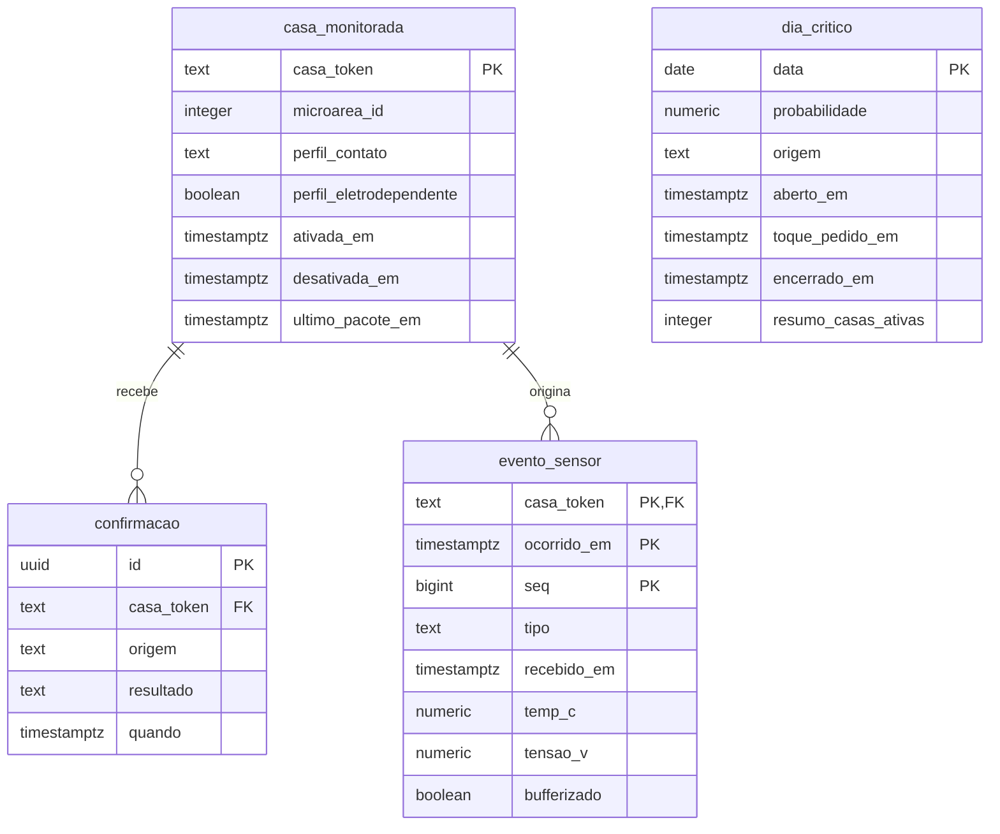
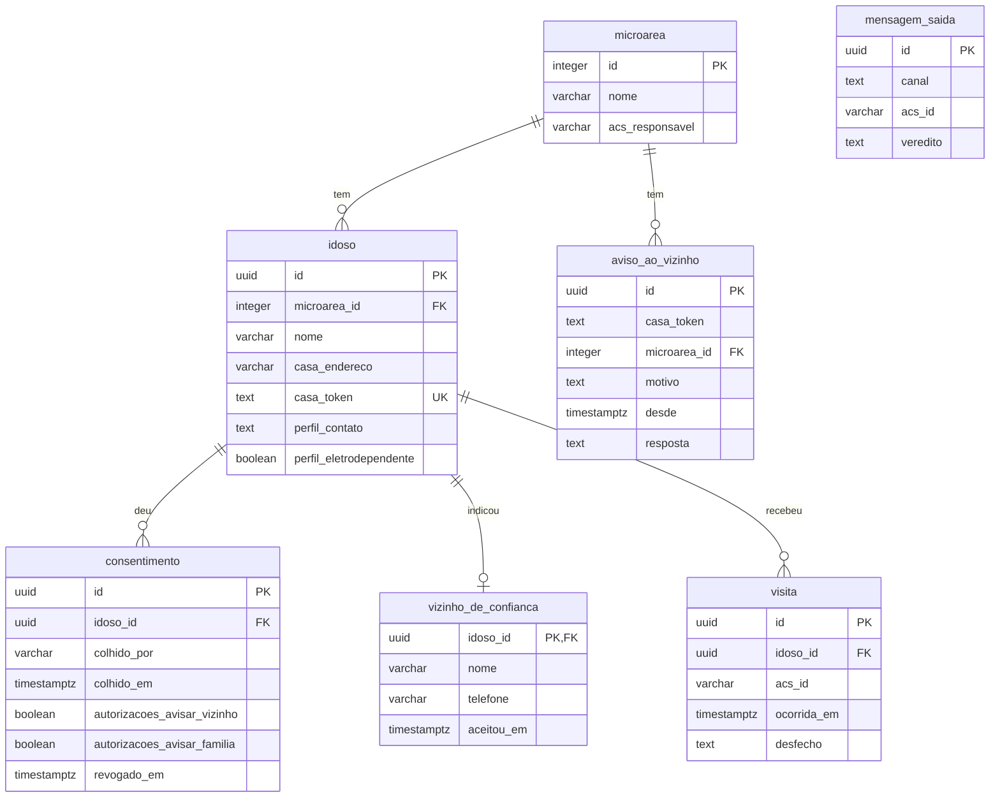
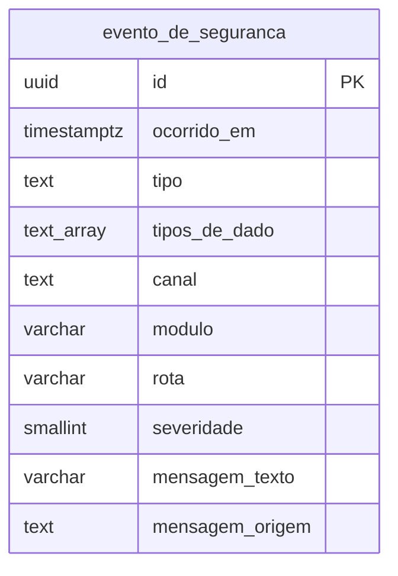
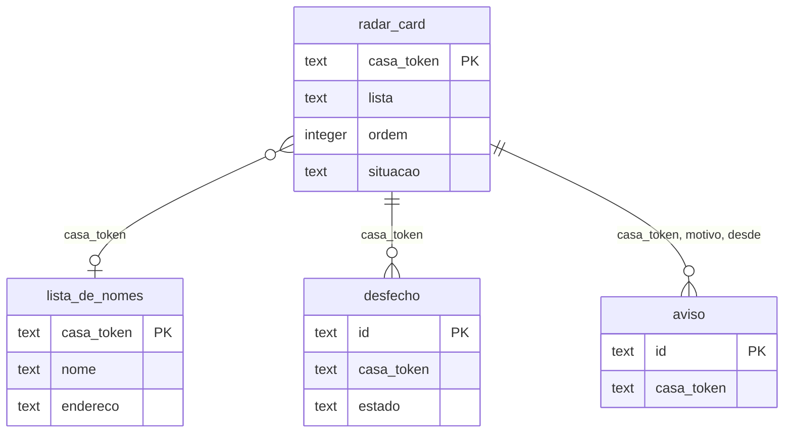

# Modelo de dados do Corredor Aceso

Este documento define onde cada dado do Corredor Aceso fica gravado, com que forma, por quanto tempo e quem pode ver. Ele cobre o Postgres, o mapeamento do EF Core, as consultas, a retenção, a classificação dos dados, o SQLite do app, as mensagens, os arquivos de ML e a carga da demo.

A fonte de verdade é [03-modelo-de-dominio.md](03-modelo-de-dominio.md). Quando este documento cita "invariante 2 de `EventoSensor`" ou "caso 31", o número é o daquele documento.

O Motor depende das seções 1.2, 1.5, 2, 3 e 4. O Cadastro depende das seções 1.3, 1.5, 2, 3 e 5, e a Guarda, das seções 1.4, 1.8, 2.5 e 5. O app depende das seções 6 e 7.2. O nó depende da seção 7.1, o ML da seção 7.3 e a infra das seções 1.7, 1.8, 2.8 e 8.

Cada bloco de SQL e de C# deste documento é cópia de um arquivo que rodou contra um Postgres 16 ou um SQLite. Os arquivos estão em [referencia/dados/](referencia/dados/). O [LEIA-ME.md](referencia/dados/LEIA-ME.md) descreve como repetir cada execução.

## Verificação realizada e limitações

Todos os números desta seção saem da última rodada de `verificar_tudo.sh`, num contêiner `postgres:16` (16.16), com o SDK do .NET 10.0.103, EF Core 10.0.15, Npgsql 10.0.3, EFCore.NamingConventions 10.0.1, `dotnet-ef` 10.0.15, `sqlite3` 3.51 e Python 3.14.

| Script | O que prova | Resultado |
|---|---|---|
| `comparar_ef.sh` | O mapeamento do EF Core gera o mesmo catálogo que `ddl/*.sql`: colunas, restrições, índices, comentários de classificação, gatilhos, funções e a carga da microárea | 279 linhas iguais, com 88 comentários |
| `conferir_migracoes.sh` | As migrações batem com o modelo. O SQL de `dotnet ef migrations script --idempotent --no-transactions` roda como `corredor_<modulo>_migra`, com `psql --single-transaction`, depois de um `pg_dump`, duas vezes, e deixa o mesmo catálogo do DDL. Um erro no fim do script não deixa nada aplicado, e o mesmo erro num script sem `--no-transactions` deixa cinco tabelas. A conferência aditiva aceita os três scripts e recusa um `DROP COLUMN`. | passa |
| `testar_sql.sh` | Cada restrição e cada gatilho recusa o que a invariante proíbe. O `Expurgo` e o reinício da demo fazem o que a seção 4 e a seção 8.4 dizem. | 86 conferências |
| `testar_papeis.sh` | Cada papel do módulo só enxerga o próprio schema, e os gatilhos valem para o papel da API | 13 conferências |
| `ef/`, com `dotnet run -- consultar` | Agregados gravados e lidos pelo EF Core, conflito de `xmin`, `RegistrarPacote`, a corrida entre pacote e revogação, `text[]`, o `Expurgo` pelo Npgsql, as consultas da seção 3 e os planos, tudo conectado como `corredor_motor`, `corredor_cadastro` e `corredor_guarda` | 32 conferências |
| `testar_sqlite.sh` | O esquema do app, a junção do radar e a fila de desfechos | 15 conferências |
| `semente/` | A semente confere com o gerador, segue as regras da seção 8.1 e a pasta não tem dado com forma de dado real. A varredura falha com um CPF válido, um telefone com DDD 11 e um e-mail real plantados. | passa |
| `montar.py --conferir` | Todo bloco de código deste documento é cópia do arquivo conferido | passa |
| `log_do_servidor.sh` | O log do Postgres com e sem as duas linhas da seção 1.8 | saída na seção 1.8 |

Esta conferência não cobriu os seguintes pontos:

- Quando esta conferência rodou, o código dos módulos não existia. A API, o `Corredor.Api --semear` da seção 8.2, o deslocamento de `ocorridaEm` em `POST /visitas` e a fila de desfechos em TypeScript não rodaram aqui. Eles foram escritos depois e rodaram juntos na demo integrada, documentada no [relatório da integração](../evidencias/integracao/RELATORIO.md).
- O modo de CI de `conferir_migracao_aditiva.sh`, que compara com a `main` por `git diff`, não rodou. Rodou só o modo `--sql`.
- O SQL do app rodou no `sqlite3` 3.51, não no `expo-sqlite`.
- Os diagramas Mermaid da seção 9 não foram renderizados.
- O custo de ler a linha inteira com `ComplexProperty`, que decidiu o mapeamento de `Casa` na seção 2.3, foi medido no EF Core 8, numa versão anterior deste modelo. Esta rodada usou o EF Core 10 e conferiu só que o mapeamento escolhido lê cinco colunas.

O modelo tem as seguintes limitações conhecidas:

- **Nome e campos de saúde ficam sem cifra no banco.** A chave ficaria na mesma VM do banco, o que protege pouco, e uma chave perdida derrubaria a demo. As colunas são `varchar`, e o `ConversorDeTextoRotulado` é o único ponto por onde o valor entra e sai do banco. Cifrar exigiria trocar o corpo do conversor por AES-GCM com uma chave fora do banco, alargar as colunas numa migração aditiva para caber o texto cifrado em base64 e regravar as linhas existentes. Os `CHECK` `sem_cpf_em_claro` e `btrim(nome) <> ''` deixariam de enxergar o texto e sairiam. A lista de nomes não mudaria, porque decifra na leitura.
- **A revogação não apaga `condicoes` e `medicamentos`.** O dado de saúde fica sem uso depois que o monitoramento acaba. Apagá-lo exige um `UPDATE` no caso de uso e uma linha a mais no caso 33.
- **`aviso_ao_vizinho` e `mensagem_saida` não têm prazo fora da revogação.** O `Expurgo` atual só toca o schema `motor`. Um prazo exigiria duas instruções num expurgo do Cadastro.
- **A linha do tempo não mostra a leitura baixa guardada além de 24 horas.** No caso 31, a casa fica vermelha por uma leitura de 25 horas que a tela de detalhe não mostra. A correção é a mesma condição do radar em `LinhaDoTempo`.
- **`CasaToken.ToString()` devolve o token inteiro.** Um token interpolado num log por engano sai completo. Abreviá-lo muda `Corredor.Contratos`.
- **`dia_critico.motivo` é o único texto livre do Motor, e o Motor não rotula nome nem saúde.** No escopo atual, só o job escreve o motivo. A origem `Manual` precisaria de uma lista fechada de motivos antes de ganhar tela.
- **O app não lê a probabilidade nem o motivo do dia crítico.** `GET /radar` não tem o campo `diaCritico`, e o `radar_cabecalho` não tem a coluna.
- **Num apagão de mais de 24 horas, o `Desde` da regra de energia anda uma hora por vez.** Cada passo é um episódio novo para o vizinho. A bateria do nó não dura esse tempo.

## 1. Postgres

### 1.1 Regras que valem para os três schemas

- **Um banco, três schemas.** O banco se chama `corredor`. Os schemas são `motor`, `cadastro` e `guarda`. Nenhuma chave estrangeira cruza schema. `casa_token` e `microarea_id` aparecem em `motor` e em `cadastro` sem ligação no banco, porque nenhum módulo lê o schema de outro. A seção 1.7 faz o Postgres garantir isso.
- **Nomes.** Tabela e coluna em `snake_case`, sem acento. A coluna de um objeto de valor leva o nome da propriedade como prefixo: `perfil_contato`, `casa_token`, `resumo_atendidas`, `autorizacoes_avisar_vizinho`, `mensagem_texto`.
- **`CasaToken`.** Coluna `text` com `CHECK (casa_token ~ '^[0-9a-f]{32}$')`. O valor gravado é o mesmo texto do tópico MQTT, do JSON e do SQLite. Na depuração, o token copiado do log entra direto no `psql`.
- **Enum.** Coluna `text` com `CHECK (... IN (...))`. O valor gravado é o nome do membro em C#, como `Sozinho` e `PessoaVista`.
- **Instante.** Coluna `timestamptz`, sempre em UTC, com precisão de microssegundo. A data do dia crítico é `date`.
- **Texto digitado por pessoa.** Coluna `varchar(n)`. O `n` é o mesmo limite que a rota valida. A seção 7.2 tem a tabela.
- **Sem `DEFAULT` e sem coluna gerada.** O domínio fornece todo valor. Um `DEFAULT` esconderia um campo esquecido. Nenhuma chave é `serial`. O token, o `Guid` e a data nascem no domínio ou no celular.
- **Nenhum `CHECK` compara duas horas nem usa `now()`.** O `RelogioDeDemo` pode andar para trás, e a tolerância e a retenção são parâmetros. Toda regra de tempo fica no domínio.
- **Toda coluna tem a classificação no comentário.** O texto segue o formato `classe=pessoal; rotulo=Nome`. A seção 2.5 diz como o EF Core grava o comentário e a seção 5 explica cada classe.

### 1.2 Schema `motor`

| Tabela | Agregado | Linhas na entrega |
|---|---|---|
| `casa_monitorada` | raiz `CasaMonitorada` | 40 |
| `confirmacao` | entidade interna de `CasaMonitorada` | dezenas por dia. Some em 24 horas. |
| `evento_sensor` | raiz `EventoSensor` | cerca de 300 por casa por dia, com telemetria a cada 5 minutos. Some em 24 horas. |
| `dia_critico` | raiz `DiaCritico`, com o `ResumoDoTurno` | uma por dia crítico |

O Motor não tem tabela de alerta, de situação, de turno, de pedido de contato nem de heartbeat. O deslocamento do `RelogioDeDemo` fica em memória, e um reinício da API o perde. Depois do reinício, o `PUT /api/demo/relogio` precisa ser chamado de novo.

O que cada restrição e cada índice garante:

| Objeto | Garante |
|---|---|
| `pk_casa_monitorada (casa_token)` | Identidade da raiz. Chave de idempotência de `AtivarCasa`, `DefinirPerfil` e `DesativarCasa`. A linha da casa desativada fica, então o token nunca volta. |
| `ck_casa_monitorada_token` | O formato que `CasaToken.TryParse` aceita: 32 hexadecimais minúsculos, 128 bits. |
| `ck_casa_monitorada_perfil_contato` | Os três valores de `PerfilDeContato`. |
| `ultimo_pacote_em` nulo | A casa que nunca mandou pacote, do caso 15. |
| ausência de coluna de texto | Invariante 6 de `CasaMonitorada`. A tabela só tem token, número, enum, booleano e hora. |
| `ix_casa_monitorada_microarea_ativa` | O radar lê as casas ativas de uma microárea. |
| `pk_confirmacao (id)` | Invariante 4 de `CasaMonitorada` e chave de `Confirmar`. O `id` é o da visita ou o do aviso. |
| `fk_confirmacao_casa_monitorada` | Confirmação só de casa conhecida. |
| `ck_confirmacao_vizinho_so_ve_pessoa` | Seção 5.7 do domínio: o vizinho nunca manda `AusenciaConfirmada`. |
| `ix_confirmacao_casa_quando` | As confirmações de uma casa em ordem de hora. |
| `pk_evento_sensor (casa_token, ocorrido_em, seq)` | Invariante 1 de `EventoSensor` e chave `(casaToken, seq, ts)` de `RegistrarPacote`. `ocorrido_em` vem antes de `seq` para o mesmo índice servir a linha do tempo. |
| `fk_evento_sensor_casa_monitorada`, `RESTRICT` | Invariante 4 de `EventoSensor` e política P2: não existe evento de token desconhecido. Uma casa com evento não pode ser apagada. |
| `ck_evento_sensor_tipo` | Invariante 2: `Heartbeat` nunca vira linha. |
| `ck_evento_sensor_temp_c`, `ck_evento_sensor_tensao_v` | Invariante 5: as faixas de -10 a 60 °C e de 0 a 260 V. |
| `ck_evento_sensor_leitura_so_na_telemetria` | Seção 6.2 do domínio: o Motor só lê `tempC` e `tensaoV` de `TELEMETRIA`. |
| `pk_dia_critico (data)` | Invariante 1 de `DiaCritico` e chave de `DeclararDiaCritico` e de `EncerrarTurno`. |
| `ck_dia_critico_probabilidade`, `ck_dia_critico_motivo`, `varchar(200)` | Invariante 3. |
| `toque_pedido_em` | Invariante 6 e chave de `PedirToque`: a coluna preenchida. |
| `ck_dia_critico_resumo_so_no_encerramento` | Invariante 7: o encerramento e os cinco números do resumo nascem juntos. |
| `ck_dia_critico_resumo_faixa` | Os números do resumo cabem no total de casas ativas. |

```sql
@@arquivo ddl/motor.sql@@
```

### 1.3 Schema `cadastro`

| Tabela | Agregado | Observação |
|---|---|---|
| `microarea` | referência `Microarea` | Uma linha, criada pela migração. |
| `idoso` | raiz `Idoso`, com as colunas de `Casa` e de `PerfilDaCasa` | 40 linhas na demo. |
| `consentimento` | entidade interna de `Idoso` | Só cresce. O revogado fica com a data. |
| `vizinho_de_confianca` | entidade interna de `Idoso` | No máximo uma linha por idoso. Dado de outra pessoa. |
| `visita` | raiz `Visita` | Só `INSERT`. Sem prazo. |
| `mensagem_saida` | raiz `MensagemSaida` | Só `INSERT`. Só o texto mascarado. |
| `aviso_ao_vizinho` | raiz `AvisoAoVizinho` | Uma linha por episódio. |

O Cadastro não tem tabela de ACS, de família nem de usuário. `AcsId` é um código de texto, como `acs-demo-01`, que vem da autenticação. O nome da ACS não é gravado em lugar nenhum.

O token fica em `idoso.casa_token`, como o modelo de domínio põe na `Casa`. A regra "sem consentimento vigente não há token" cruza duas tabelas, e um `CHECK` não alcança outra tabela. Um gatilho de restrição adiado, na seção 1.5, confere a regra no `COMMIT`. O banco recusa token sem consentimento vigente, consentimento vigente sem token e revogação que deixa o token.

| Objeto | Garante |
|---|---|
| `ck_idoso_nome`, `ck_idoso_casa_endereco`, `NOT NULL` | Invariante 9 de `Idoso`: nome e endereço obrigatórios. |
| `ux_idoso_casa_token` | Um token aponta para um idoso só. É o caminho de `POST /visitas` e do `ReceptorDeContato`. |
| `casa_token` nulo e o gatilho `idoso_token_com_consentimento` | Invariantes 1 e 8: o idoso tem token se, e somente se, tem consentimento vigente. |
| `ix_idoso_microarea_com_token` | A lista de nomes lê os idosos com token de uma microárea. |
| ausência de coluna de CPF, RG, CNS e nascimento | Invariante 10. |
| `ck_..._sem_cpf_em_claro`, em quatro tabelas | Rede de segurança do caso 38. Se o interceptador falhar, o banco recusa um CPF pontuado em claro, com dígito válido ou não. O detector continua sendo o `pii.json`. |
| `ux_consentimento_vigente`, índice único parcial | Invariante 2: no máximo um consentimento sem `revogado_em` por idoso. |
| `colhido_por`, `colhido_em`, `versao_do_termo`, `NOT NULL` | Invariante 3: quem colheu, quando e qual termo. |
| `pk_vizinho_de_confianca (idoso_id)` | No máximo um vizinho. Indicar de novo substitui a linha. |
| `aceitou_em`, `NOT NULL` | Invariante 6: o vizinho só entra com a data em que aceitou. |
| `pk_visita (id)` | Invariante 2 de `Visita` e chave de `RegistrarVisita`. O `id` nasce no celular. |
| `fk_visita_idoso`, `RESTRICT` | Invariante 6 de `Visita`: apagar o idoso não apaga a visita. |
| `ck_mensagem_saida_bloqueada_tem_tipo` | Metade da invariante 2 de `MensagemSaida`: mensagem bloqueada tem pelo menos um tipo de dado. |
| `ux_aviso_ao_vizinho_episodio (casa_token, motivo, desde)` | Invariante 1 de `AvisoAoVizinho` e chave do pedido de contato. |
| `ck_aviso_ao_vizinho_resposta_com_hora` | A resposta e a hora da resposta nascem juntas. |
| `ix_aviso_ao_vizinho_microarea_registrado` | `GET /avisos` lê os avisos das últimas 24 horas de uma microárea. |

`aviso_ao_vizinho` não guarda o texto enviado, o telefone nem o nome do vizinho. O texto é fixo e o telefone mora em `vizinho_de_confianca`. A linha é o registro do envio simulado. `microarea_id` deixa `GET /avisos` filtrar sem passar pelo token, que some na revogação.

```sql
@@arquivo ddl/cadastro.sql@@
```

### 1.4 Schema `guarda`

A Guarda tem uma tabela só, como decidiu o hotspot H44 do [event storming](02-event-storming.md). `RegraDePii` fica no arquivo `Regras/pii.json`. `PoliticaDeCanal` fica num dicionário no código.

| Objeto | Garante |
|---|---|
| ausência de coluna de valor, de ACS, de IP e de agente do navegador | Invariantes 1 e 4 de `EventoDeSeguranca`. |
| `ck_evento_de_seguranca_rota_sem_identificador` | Invariante 1. `rota` guarda o modelo da rota, como `/api/idosos/{id}/vizinho`. O banco recusa um `Guid`, um token ou uma query string. |
| `ck_evento_de_seguranca_tipos_de_dado` | Invariante 2: a lista não é vazia e só tem membros de `TipoDeDado`. |
| `ck_evento_de_seguranca_severidade` | Invariante 2: de 1 a 5. |
| `ck_evento_de_seguranca_mensagem_inteira` | Invariante 3: o texto e a origem da mensagem ao cidadão entram juntos. |
| `ix_evento_de_seguranca_ocorrido_em` | O painel lê os eventos das últimas 24 horas, do mais novo para o mais velho. |

O mascaramento na entrada grava o canal `Banco`. Ele protege o que vai para o banco e para o log, e o canal `Banco` tem exposição 1, então a pontuação fica igual à de um canal nulo.

```sql
@@arquivo ddl/guarda.sql@@
```

### 1.5 Gatilhos

Cada contexto tem uma segunda migração, `Gatilhos`, que só chama `migrationBuilder.Sql(...)`. O SQL fica em `ddl/<schema>_gatilhos.sql`, embutido no assembly. A migração e o DDL de referência leem o mesmo arquivo:

```csharp
@@trecho ef/Migrations/Cadastro/20261117025836_Gatilhos.cs ## protected override void Up ## }@@
```

| Tabela | O gatilho recusa | Invariante |
|---|---|---|
| `motor.evento_sensor` | `UPDATE`. O `DELETE` continua, para o `Expurgo` e para `DesativarCasa`. | `EventoSensor` é imutável. |
| `cadastro.visita` | `UPDATE` e `DELETE` | Invariante 1 de `Visita`. |
| `cadastro.mensagem_saida` | `UPDATE` e `DELETE` | Invariante 4 de `MensagemSaida`. |
| `guarda.evento_de_seguranca` | `DELETE`, e todo `UPDATE` que não seja anexar a mensagem pela primeira vez | Invariantes 3 e 5 de `EventoDeSeguranca`. |
| `cadastro.idoso`, `cadastro.consentimento` | No `COMMIT`, um idoso com token e sem consentimento vigente, ou com consentimento vigente e sem token | Invariantes 1 e 8 de `Idoso`. |

O gatilho do token é `DEFERRABLE INITIALLY DEFERRED`. O caso de uso grava o consentimento e o token na mesma transação, e a conferência espera o `COMMIT`. Um `SET CONSTRAINTS ALL IMMEDIATE` antecipa a conferência, e os testes usam isso para ver a recusa. A conferência do EF Core registra, revoga e registra de novo um consentimento com o gatilho ligado. `volume.sql` grava idosos e consentimentos numa transação só pelo mesmo motivo.

`TRUNCATE` não dispara gatilho de linha. O reinício da demo, da seção 8.4, usa isso.

```sql
@@arquivo ddl/motor_gatilhos.sql@@
```

```sql
@@arquivo ddl/cadastro_gatilhos.sql@@
```

```sql
@@arquivo ddl/guarda_gatilhos.sql@@
```

### 1.6 Quem garante cada invariante

"Banco" quer dizer que uma instrução que viola a regra falha, mesmo com erro no código. "Domínio" quer dizer que só o código C# impede.

| Agregado | Invariante | Banco | Domínio |
|---|---|---|---|
| `CasaMonitorada` | 1. Token e microárea não mudam | | Sem método que troque |
| | 2. `UltimoPacoteEm` só anda para frente | A instrução de `RegistrarPacote` compara na própria linha, seção 3.2 | Método da raiz, para os testes |
| | 3. Casa desativada não aceita nada, e a linha fica | O pacote passa por `WHERE desativada_em IS NULL`. A linha fica por causa do `RESTRICT`. | Recusa perfil e confirmação |
| | 4. `Id` de confirmação repetido | `pk_confirmacao` | Ignora antes de gravar |
| | 5. `Quando` no futuro ou com mais de 24 horas | | Depende do relógio |
| | 6. Sem nome, endereço ou texto | Não existe coluna | O projeto não referencia `TextoRotulado` |
| `EventoSensor` | 1. Chave única | `pk_evento_sensor` e `ON CONFLICT DO NOTHING` | |
| | 2. Nunca `Heartbeat` | `ck_evento_sensor_tipo` | |
| | 3. `ts` adiantado ou velho | | Depende do relógio e de `ToleranciaDoRelogio` |
| | 4. Só para casa ativa | A chave estrangeira exige casa conhecida. A instrução de `RegistrarPacote` exige casa ativa. | |
| | 5. Faixas de leitura | `CHECK` recusa | Grava como ausente antes |
| `DiaCritico` | 1. Um por data | `pk_dia_critico` | |
| | 2. A data é hoje | | Depende do relógio |
| | 3. Probabilidade e motivo | `CHECK` e `varchar(200)` | |
| | 4 e 5. Declarar de novo | | `AbertoEm` não muda. Recusa depois do encerramento. |
| | 6. Um toque por dia | | Coluna `toque_pedido_em` preenchida |
| | 7. Um encerramento, resumo fixo | `CHECK` do resumo e conferência do `xmin` | Encerrar de novo devolve o mesmo resumo |
| `Idoso` | 1 e 8. Token se, e somente se, há consentimento vigente | Gatilho `idoso_token_com_consentimento`, no `COMMIT` | Gera e apaga o token |
| | 2. Um consentimento vigente | `ux_consentimento_vigente` | |
| | 3. Quem, quando, versão | `NOT NULL` | Data não está no futuro |
| | 4 e 5. Token aleatório, o mesmo na repetição | Formato e unicidade do token | `CasaToken.Novo()` e o consentimento vigente |
| | 6 e 7. Vizinho e família só com autorização | Um vizinho, com `aceitou_em` | Confere a autorização |
| | 8. Revogar remove o vizinho | | Uma transação, seção 4.3 |
| | 9. Nome e endereço | `NOT NULL` e `CHECK` | O rótulo vem do conversor, seção 2.4 |
| | 10. Sem CPF, RG, CNS, nascimento | Não existe coluna. CPF pontuado recusado. | Interceptador mascara |
| `Visita` | 1. Não muda e não some | Gatilho | Sem método |
| | 2. `Id` repetido | `pk_visita` | Devolve a que existe |
| | 3 e 4. Hora e token ativo | | Depende do relógio e do `Idoso` |
| | 6. Sobrevive ao expurgo e à revogação | `RESTRICT`, gatilho | O `Expurgo` só toca o schema `motor` |
| `MensagemSaida` | 1 e 4. Nasce com veredito, que não muda | `NOT NULL`, gatilho | |
| | 2. Bloqueada se, e só se, há tipo proibido | Bloqueada tem tipo | A `PoliticaDeCanal` decide |
| | 3. Só o texto mascarado | CPF pontuado recusado | `TextoRotulado.ToString()` |
| `AvisoAoVizinho` | 1. Um por episódio | `ux_aviso_ao_vizinho_episodio` | |
| | 2. Só com autorização e vizinho | | `Idoso.PodeAvisarVizinho` |
| | 3. Uma resposta | Conferência do `xmin`, resposta com hora | Recusa resposta diferente |
| `EventoDeSeguranca` | 1 e 4. Sem valor e sem ACS | Não existe coluna. `rota` sem identificador. | |
| | 2. Tipos e severidade | `CHECK` | A severidade é a maior |
| | 3 e 5. Mensagem uma vez, sem alterar | Gatilho | |
| Todos | Nenhum módulo lê o schema de outro | Papel por módulo, seção 1.7 | O projeto não referencia o outro |

### 1.7 Um papel por módulo

O [bd-modulo.sql](referencia/repo/infra/config/bd-modulo.sql) da infra cria dois papéis por módulo, na VM e no CI. `corredor_<modulo>_migra` é dono do schema e roda as migrações. `corredor_<modulo>` é o papel da API: lê e escreve no schema do módulo e não muda tabela. Nenhum dos dois enxerga outro schema. As permissões das tabelas novas saem de `ALTER DEFAULT PRIVILEGES`, então uma migração aditiva não precisa de `GRANT`.

`conferir_migracoes.sh` roda esse mesmo arquivo antes de aplicar as migrações. `testar_papeis.sh` entra pela rede como cada papel:

| Tentativa | Resultado |
|---|---|
| `corredor_motor` lê `motor.casa_monitorada` | aceito |
| `corredor_motor` lê `cadastro.idoso` ou `guarda.evento_de_seguranca` | `permission denied for schema` |
| `corredor_cadastro` lê `motor.casa_monitorada` | `permission denied for schema motor` |
| `corredor_guarda` lê `cadastro.idoso` | `permission denied for schema cadastro` |
| `corredor_motor_migra` lê `cadastro.idoso` | `permission denied for schema cadastro` |
| `corredor_motor` cria tabela em `motor` | `permission denied for schema motor` |
| `corredor_motor` faz `TRUNCATE motor.evento_sensor` | `permission denied` |
| `corredor_cadastro` grava idoso e visita | aceito |
| `corredor_cadastro` altera visita, ou grava token sem consentimento | recusado pelo gatilho |
| `corredor_guarda` grava evento e depois tenta apagar | grava, e o gatilho recusa o `DELETE` |

As 32 conferências do EF Core rodam conectadas como os três papéis da API. A API usa três strings de conexão, `ConnectionStrings__Motor`, `ConnectionStrings__Cadastro` e `ConnectionStrings__Guarda`. Na máquina de desenvolvimento, as três podem apontar para o `postgres`.

### 1.8 Configuração do servidor que este modelo exige

O Postgres grava no próprio log a linha inteira que uma restrição recusa. Com a configuração padrão, um `INSERT` recusado em `cadastro.idoso` deixou isto no log do servidor, no teste `log_do_servidor.sh`:

```
ERROR:  new row for relation "idoso" violates check constraint "ck_idoso_sem_cpf_em_claro"
DETAIL:  Failing row contains (da17..., 3, Dirce Aroeira, doc 123.456.789-00, null, Sozinho, f, Rua do Sabia, 30 - Vila Exemplo, null).
STATEMENT:  INSERT INTO cadastro.idoso (id, microarea_id, nome, ...) VALUES (gen_random_uuid(), 3, 'Dirce Aroeira', ...
```

Esse log é um canal de saída que a Guarda não vê. O `infra/02-app.sh` grava duas linhas no `postgresql.conf`:

```
log_error_verbosity = terse
log_min_error_statement = panic
```

Com as duas, o mesmo `INSERT` deixou só a linha `ERROR`, sem `DETAIL` e sem `STATEMENT`. A mensagem do gatilho do token não tem valor de coluna.

Na API, a mesma regra vale para o EF Core e para o Npgsql:

- A API nunca chama `EnableSensitiveDataLogging()`. Esse método escreve no log o valor de cada parâmetro, depois que o conversor já tirou o texto de dentro do `TextoRotulado`.
- A string de conexão não leva `Include Error Detail=true`. Esse parâmetro copia o `DETAIL` do Postgres para a mensagem da exceção.

## 2. Mapeamento no EF Core

O mapeamento desta seção está inteiro em `ef/Contextos.cs` e `ef/Classificacao.cs`. Ele compila com .NET 10, EF Core 10.0.15, Npgsql 10.0.3 e EFCore.NamingConventions 10.0.1, as versões da infra. `comparar_ef.sh` prova que ele gera o mesmo catálogo que o DDL da seção 1, com 279 linhas iguais.

### 2.1 Um `DbContext` por schema

| Contexto | Projeto | Schema | Pasta das migrações | Tabela de histórico |
|---|---|---|---|---|
| `MotorDbContext` | `Corredor.Motor` | `motor` | `api/src/Corredor.Motor/Infra/Migrations` | `motor.__EFMigrationsHistory` |
| `CadastroDbContext` | `Corredor.Cadastro` | `cadastro` | `api/src/Corredor.Cadastro/Infra/Migrations` | `cadastro.__EFMigrationsHistory` |
| `GuardaDbContext` | `Corredor.Guarda` | `guarda` | `api/src/Corredor.Guarda/Infra/Migrations` | `guarda.__EFMigrationsHistory` |

Cada módulo registra o próprio contexto dentro de `AddMotor`, `AddCadastro` e `AddGuarda`, com a string de conexão do módulo e estas opções:

```csharp
@@trecho ef/Fabricas.cs ## public static DbContextOptions<T> Opcoes<T> ## .Options;@@
```

`UseSnakeCaseNamingConvention()` gera `perfil_contato` a partir de `Perfil.Contato` e `casa_token` a partir de `Casa.Token`. Só seis colunas precisam de `HasColumnName`: `casa_token` e `microarea_id` na raiz do Motor, `microarea_id` no `Idoso` e no `AvisoAoVizinho`, `idoso_id` no vizinho e `resumo_com_sinal_de_vida_ate_10h`. A convenção também vale para a tabela de histórico, que fica com as colunas `migration_id` e `product_version`.

### 2.2 Tipos de valor, enums, token e hora

Cada contexto declara as conversões uma vez, por tipo, em `ConfigureConventions`. Nenhuma propriedade repete a conversão.

```csharp
@@trecho ef/Contextos.cs ## c.Properties<CasaToken>().HaveConversion<CasaTokenConverter>(); ## c.Conventions.Add(_ => new ConvencaoDeClassificacao(Classificacao.Motor));@@
```

```csharp
@@trecho ef/Contextos.cs ## public sealed class CasaTokenConverter() ## public sealed class TensaoVConverter()@@
```

`TempC` e `TensaoV` continuam objetos de valor, como o modelo de domínio diz. O operador de comparação deixa o radar escrever `e.TensaoV < tensaoMinima`, e o EF Core traduz para `tensao_v < @tensaoMinima`. A saída está em `saida/consultas.txt`.

```csharp
@@trecho ef/Tipos.cs ## public readonly record struct TensaoV(decimal Valor) ## }@@
```

| Tipo do domínio | Coluna | Como |
|---|---|---|
| `CasaToken` | `text` | `CasaTokenConverter`. Na leitura, um valor fora do formato lança exceção. |
| `MicroareaId`, `IdosoId`, `AcsId` | `integer`, `uuid`, `varchar(40)` | Um conversor de uma linha por tipo. |
| Todo `enum` | `text` | `Properties<Enum>().HaveConversion<string>()`. |
| `DateTimeOffset` | `timestamptz` | `UtcConverter`. O Npgsql recusa gravar um `DateTimeOffset` com deslocamento diferente de zero. O conversor normaliza a hora que chega do app com `-03:00`. |
| `DateOnly` | `date` | Nativo. |
| `Probabilidade` | `numeric(4,3)` | Conversor na propriedade, com `HasPrecision(4, 3)`. |
| `TempC`, `TensaoV` | `numeric(4,1)`, `numeric(5,1)` | Conversor e precisão por convenção. |
| `PerfilDaCasa` | duas colunas na tabela da raiz | `ComplexProperty`. |
| `ResumoDoTurno`, `MensagemAoCidadao` | colunas nulas na tabela da raiz | `OwnsOne`. |
| `Autorizacoes` | duas colunas em `consentimento` | `OwnsOne` dentro do `OwnsMany`. |
| Lista de `TipoDeDado` | `text[]` | `PrimitiveCollection(...).ElementType().HasConversion<string>()`. |
| `TextoRotulado` | `varchar(n)` | `ConversorDeTextoRotulado`, seção 2.4. |
| `TurnoRadar`, `JanelaDeContato`, `Alerta`, `Avaliacao` | nenhuma | Calculados. Não entram no modelo do EF Core. |

Os conversores de `CasaToken` e de `MicroareaId` aparecem no Motor e no Cadastro, três linhas em cada um. `Corredor.Contratos` não referencia o EF Core e não pode guardá-los.

O `timestamptz` guarda microssegundos, e o .NET guarda décimos de microssegundo. O Npgsql corta a hora no microssegundo ao gravar e ao mandar o parâmetro de uma consulta. A conferência gravou um `Desde` com 7 décimos de microssegundo e achou o aviso pela chave do episódio com o mesmo valor em memória, sem código de corte. O valor que fica no objeto rastreado depois do `SaveChanges` continua com os décimos. Uma comparação de horas usa duas leituras do banco, nunca uma hora da memória e uma do banco.

### 2.3 Tipo possuído, tipo complexo ou tabela

| Classe | Mapeamento | Tabela |
|---|---|---|
| `CasaMonitorada` | entidade | `casa_monitorada` |
| `Confirmacao`, o registro de `Corredor.Contratos` | `OwnsMany`, chave `Id` | `confirmacao` |
| `EventoSensor` | entidade com chave composta e chave estrangeira sem navegação | `evento_sensor` |
| `DiaCritico` | entidade | `dia_critico` |
| `Idoso` | entidade | `idoso` |
| `Casa` | `OwnsOne` obrigatório, na tabela da raiz | `idoso` |
| `Consentimento` | `OwnsMany`, chave `Id` | `consentimento` |
| `VizinhoDeConfianca` | `OwnsOne` opcional com `ToTable` | `vizinho_de_confianca` |
| `Visita`, `MensagemSaida`, `AvisoAoVizinho`, `Microarea` | entidades | uma tabela cada |
| `EventoDeSeguranca` | entidade | `evento_de_seguranca` |

`Casa` é `OwnsOne`, não `ComplexProperty`. Uma medição no EF Core 8, numa versão anterior deste modelo, mostrou que a projeção de `i.Casa.Endereco`, com `Casa` como tipo complexo, trazia a linha inteira do idoso, com `condicoes` e `medicamentos`. Com `OwnsOne`, a lista de nomes lê cinco colunas, e uma conferência do EF Core falha se o SQL da lista citar `condicoes` ou `medicamentos`.

O tipo possuído é carregado sempre junto com a raiz. É o que o agregado pede. `CasaMonitorada` chega com as confirmações, e `Idoso` chega com a casa, os consentimentos e o vizinho.

A raiz do Motor, com o tipo complexo, a coleção possuída e o índice parcial:

```csharp
@@trecho ef/Contextos.cs ## b.Entity<CasaMonitorada>(e => ## o.HasIndex("CasaToken", nameof(Confirmacao.Quando))@@
```

A raiz do Cadastro, com `TextoRotulado`, a casa na mesma tabela, o índice único parcial e o vizinho em tabela própria:

```csharp
@@trecho ef/Contextos.cs ## e.HasKey(i => i.Id).HasName("pk_idoso"); ## v.Property(x => x.Telefone).HasConversion@@
```

Cada `CHECK` da seção 1 entra no mapeamento com `t.HasCheckConstraint(nome, sql)`, dentro de `ToTable`. Assim a migração gera a restrição. `Sql.Token`, `Sql.Acs`, `Sql.Cpf` e as outras constantes guardam o trecho de SQL que se repete em mais de uma tabela.

### 2.4 `TextoRotulado`

O banco guarda só o texto. O rótulo não é gravado, porque o modelo de domínio diz que rótulo é calculado. Na leitura, o rótulo vem da coluna.

```csharp
@@trecho ef/Contextos.cs ## public sealed class ConversorDeTextoRotulado ## TextoRotulado.DoBanco(s, rotulosDaColuna));@@
```

- O conversor mora em `Corredor.Guarda`, porque só a Guarda lê o valor `internal`. Ele é a `SaidaSegura` com o canal `Banco`, que aceita todo rótulo.
- `idoso.nome` e `vizinho_de_confianca.nome` voltam com `Nome`. `casa_endereco` volta com `Endereco`. `telefone` volta com `Telefone`. `condicoes` e `medicamentos` voltam com `Saude`.
- `visita.observacao` é texto livre. Na gravação, o `TextoRotulado` chega com o rótulo `Saude`, que vem do campo, mais os rótulos do `MotorDeParsing`. Na leitura, a coluna devolve os cinco rótulos que um texto livre pode ter: `Saude`, `MoraSozinho`, `Nome`, `Endereco` e `Telefone`. Nenhum canal além do `Banco` aceita esse conjunto, então a observação não sai por engano.
- CPF, RG, CNS e credencial já chegam mascarados pelo `InterceptadorDeEntrada`. O banco grava `***.456.***-00`.

### 2.5 Classificação no comentário da coluna

A classificação de cada coluna mora numa tabela por contexto, em `ef/Classificacao.cs`. Uma convenção do EF Core grava o texto como comentário da coluna, e a migração cria o `COMMENT ON COLUMN`. Uma coluna mapeada sem entrada na tabela derruba a montagem do modelo, então nenhuma coluna nova fica sem classificação.

```csharp
@@trecho ef/Classificacao.cs ## public static readonly IReadOnlyDictionary<string, string> Guarda ## };@@
```

```csharp
@@trecho ef/Classificacao.cs ## public sealed class ConvencaoDeClassificacao ## propriedade.Builder.HasComment(classe);@@
```

Uma consulta ao catálogo do Postgres lista a classificação de todas as colunas:

```sql
SELECT n.nspname AS schema, c.relname AS tabela, a.attname AS coluna, d.description AS classe
FROM pg_description d
JOIN pg_class c ON c.oid = d.objoid
JOIN pg_namespace n ON n.oid = c.relnamespace
JOIN pg_attribute a ON a.attrelid = c.oid AND a.attnum = d.objsubid
WHERE n.nspname IN ('motor', 'cadastro', 'guarda')
ORDER BY 1, 2, 3;
```

`testes.sql` confere que toda coluna dos três schemas tem um comentário que começa com `classe=` e uma das cinco classes da seção 5.

### 2.6 Concorrência

| Tabela | Mecanismo | Motivo |
|---|---|---|
| `casa_monitorada` | Nenhum controle otimista. Cada escrita é uma instrução que converge. | O consumidor MQTT escreve `ultimo_pacote_em` duas vezes por segundo. Com `xmin` na linha, todo comando do Cadastro disputaria com o heartbeat. |
| `evento_sensor` | Chave primária e `ON CONFLICT DO NOTHING` | Repetição é sucesso. |
| `confirmacao` | Chave primária | Repetição é ignorada. |
| `dia_critico` | `xmin` | A ACS e o `VigiaDoRadar` podem encerrar o turno no mesmo segundo. O segundo perde, relê e devolve o resumo do primeiro. |
| `idoso` | `xmin` na raiz, `ux_consentimento_vigente` e o gatilho do token | Dois registros de consentimento ao mesmo tempo geram um token só. |
| `aviso_ao_vizinho` | `xmin` e `ux_aviso_ao_vizinho_episodio` | Com duas respostas ao mesmo tempo, a segunda relê e é recusada. |
| `visita`, `mensagem_saida`, `evento_de_seguranca` | Só `INSERT` | Não há o que disputar. |

O `xmin` é a coluna de sistema do Postgres que muda a cada escrita da linha. No EF Core ele é uma propriedade `uint` com `IsRowVersion()`. O Npgsql não cria coluna nova.

```csharp
@@trecho ef/Contextos.cs ## e.Property(d => d.Versao).IsRowVersion(); ## e.Property(d => d.Versao).IsRowVersion();@@
```

Os casos de uso seguem duas regras:

1. **Conflito de versão.** Com `DbUpdateConcurrencyException`, o caso de uso chama `ChangeTracker.Clear()` e executa de novo, uma vez. Todo comando do modelo é idempotente, então repetir é seguro. `Entry(x).ReloadAsync()` não serve, porque não recarrega o tipo possuído.
2. **Chave de idempotência repetida.** Com `DbUpdateException` cuja causa é `PostgresException` de `SqlState` `23505`, o comando é uma repetição. O caso de uso lê a linha que já existe e devolve o mesmo resultado. A regra vale para `AtivarCasa`, `DeclararDiaCritico`, `Confirmar`, `RegistrarVisita` e `RegistrarAviso`.

`IndicarVizinho` muda só a tabela filha e não passa pela conferência do `xmin`. O modelo aceita essa corrida, porque a rota só é chamada pelo Swagger, por uma pessoa de cada vez.

### 2.7 Armadilhas que a conferência encontrou

- `OwnedNavigationBuilder` não tem `ComplexProperty`. Um objeto de valor dentro de um tipo possuído usa `OwnsOne`.
- Um tipo de valor que embrulha um número só entra numa comparação do LINQ se declarar o operador. `TempC` e `TensaoV` declaram `<`, `>`, `<=` e `>=`.
- A chave de um `OwnsOne` com `ToTable` nasce com o nome `id`. `HasColumnName("idoso_id")` conserta.
- Com `HasConversion` numa propriedade `TextoRotulado?`, o compilador avisa sobre nulidade. O método `Rotulado(...)` devolve o conversor como `ValueConverter` e o aviso some.
- SQL escrito à mão não passa pelo `UtcConverter`. O Npgsql recusa um `DateTimeOffset` com `-03:00` como parâmetro, então o parâmetro passa por `.ToUniversalTime()`.
- O script idempotente do EF Core recua cada linha do `migrationBuilder.Sql`. O corpo de uma função criada pela migração difere, por espaços, do corpo criado pelo DDL. `catalogo.sql` compara o corpo sem os espaços.

### 2.8 Migrações

As migrações do EF Core são a fonte de verdade do banco. Cada contexto tem uma pasta e uma tabela de histórico. A ordem em cada contexto é `Inicial`, com as tabelas e os comentários da seção 1, e `Gatilhos`, com a seção 1.5. As seis migrações conferidas estão em `ef/Migrations/`.

Uma migração nova nasce na máquina de desenvolvimento, com estes comandos:

```bash
dotnet ef migrations add <Nome> --project api/src/Corredor.Motor \
	--startup-project api/src/Corredor.Api --context MotorDbContext --output-dir Infra/Migrations
dotnet ef migrations has-pending-model-changes --project api/src/Corredor.Motor \
	--startup-project api/src/Corredor.Api --context MotorDbContext
```

O caminho até a VM é o da [seção 1.7 de 05-infra-e-entrega.md](05-infra-e-entrega.md):

1. O `release.yml` gera um SQL por contexto com `dotnet ef migrations script --idempotent --no-transactions`.
2. O deploy guarda um `pg_dump`.
3. O deploy aplica cada SQL com `psql --single-transaction`, conectado como `corredor_<modulo>_migra`.
4. A API não migra. Não existe opção `--migrar`.

`--no-transactions` é obrigatório. Sem ele, o script traz um `START TRANSACTION` e um `COMMIT` por migração, e o primeiro `COMMIT` encerra a transação do `psql --single-transaction`. `conferir_migracoes.sh` mede os dois casos com um erro no fim do script de `motor`. Com `--no-transactions`, nenhuma tabela ficou em `motor`. Sem ele, ficaram cinco: as quatro tabelas e a de histórico. O mesmo script aplica cada SQL duas vezes e confere o catálogo depois da segunda rodada.

Regras das migrações:

1. **Um autor de migração por contexto.** É o responsável pelo módulo. Duas migrações paralelas no mesmo contexto geram conflito no arquivo `ModelSnapshot`.
2. **Migração que entrou na `main` não muda e não some.** Um erro se conserta com outra migração.
3. **Toda migração é aditiva.** Ela cria tabela, coluna anulável, índice ou restrição que as linhas atuais cumprem, ou troca um `CHECK` de enum por outro com mais valores. Ela não apaga, não renomeia e não muda o tipo de nada.
4. **O CI bloqueia a migração destrutiva.** `conferir_migracao_aditiva.sh` gera o SQL das migrações que entraram depois da `main` e recusa `DROP`, `RENAME` e `ALTER COLUMN ... TYPE`. Ele lê o SQL, então pega também o `DROP` escrito dentro de `migrationBuilder.Sql` e a troca de tipo. O `tools/conferir-migracoes.sh` da infra lê o `Up()` em C# e recusa `DropTable`, `DropColumn`, `RenameTable` e `RenameColumn`, mas não pega `AlterColumn` que muda tipo nem `DROP` dentro de `migrationBuilder.Sql`, que a migração `Gatilhos` usa. O CI pode rodar os dois scripts.

```bash
@@arquivo conferir_migracao_aditiva.sh@@
```

5. **A saída de emergência é recriar o banco.** Todo dado é simulado. `DROP DATABASE`, as migrações e a carga da seção 8 levam o banco de volta ao estado da demo.

## 3. Caminhos de acesso

As consultas desta seção estão em `ef/Acesso.cs`. Cada uma rodou como o papel do módulo contra um banco com 20 microáreas, 800 casas, 261.600 eventos de 24 horas e 3.000 eventos de segurança. O SQL gerado e o plano de cada uma estão em `saida/consultas.txt`.

### 3.1 Resumo

| Consulta | Índice que o plano usou | Observação |
|---|---|---|
| Radar: casas ativas da microárea | `ix_casa_monitorada_microarea_ativa` | As confirmações vêm na mesma consulta. |
| Radar e avaliação: eventos | leitura sequencial paralela de `evento_sensor` | Correto. A seção 3.3 explica. |
| Dia crítico de hoje | leitura sequencial | A tabela de teste tem uma linha. `pk_dia_critico` cobre a consulta quando houver mais. |
| Linha do tempo de uma casa | `pk_evento_sensor` | Já sai em ordem de `ocorrido_em`. O plano não tem `Sort`. |
| Lista de nomes | `ix_idoso_microarea_com_token` | Lê cinco colunas. Não lê `condicoes` nem `medicamentos`. |
| Idoso pelo token | `ux_idoso_casa_token` | `POST /visitas` e `ReceptorDeContato`. |
| Avisos das últimas 24 horas | `ix_aviso_ao_vizinho_microarea_registrado` | |
| Painel: lista | `ix_evento_de_seguranca_ocorrido_em` | Sem `Sort`. O índice já está em ordem decrescente. |
| Painel: contagem | `ix_evento_de_seguranca_ocorrido_em` | Agrupamento no banco. |

Com as 40 casas da entrega, cada tabela cabe em poucas páginas, e o Postgres pode preferir a leitura sequencial ao índice. Isso é esperado. Os índices passam a valer com mais de uma microárea.

### 3.2 `RegistrarPacote`

O caminho mais quente da solução não carrega o agregado. São duas instruções numa transação.

```csharp
@@trecho ef/Acesso.cs ## public static async Task<(int CasaAtiva, int EventoNovo)> RegistrarPacoteAsync( ## return (casaAtiva, eventoNovo);@@
```

- A primeira instrução devolve 1 se a casa existe e está ativa, e 0 em qualquer outro caso. Com 0, o pacote é descartado sem gravar nada. É a política P2.
- A mesma instrução só troca `ultimo_pacote_em` por uma hora maior. É a invariante 2 de `CasaMonitorada`, garantida numa instrução só.
- A linha da casa fica travada até o fim da transação. Uma revogação que chega no mesmo instante espera e depois apaga o evento que acabou de entrar. Na ordem inversa, o pacote espera a revogação e é descartado. A conferência forçou as duas ordens.
- `ON CONFLICT DO NOTHING` faz a repetição contar como sucesso. São os casos 26 e 27.
- O `ts` adiantado ou velho é recusado antes, no `TradutorDePacote`. É o caso 28.

A conferência cobre seis casos: pacote novo, pacote repetido, `seq` reiniciado, pacote com hora menor, token desconhecido e casa desativada.

### 3.3 Radar e entrada da avaliação

O radar de uma microárea e o `VigiaDoRadar` usam as mesmas três consultas. O `VigiaDoRadar` tira o filtro de microárea.

```csharp
@@trecho ef/Acesso.cs ## public static IQueryable<CasaMonitorada> CasasAtivas( ## .Where(d => d.Data == hoje);@@
```

- `desde` é `agora` menos `Retencao`. A segunda condição traz as leituras de tensão baixa de qualquer idade. O critério é o mesmo do `Expurgo`, então a avaliação dá o mesmo resultado com o expurgo em dia, atrasado ou cortado.
- A consulta de eventos lê a tabela inteira, e nenhum índice mudaria isso. Depois do expurgo, a tabela é a própria janela de 24 horas. No banco de teste, a microárea 3 trouxe 13.080 dos 261.600 eventos.
- O agrupamento por casa roda na memória, com `ToLookup(e => e.CasaToken)`. O `AvaliadorDeCasas` recebe um `HistoricoDaCasa` por token.
- A ordem de `Pendentes` e de `Atendidas` é LINQ sobre objetos, depois da avaliação: `Vermelho` antes de `Cinza`, depois a `Ordem` da regra, depois o `Desde` mais antigo. Essa parte não rodou nesta conferência. Ela está em `api/src/Corredor.Motor/Aplicacao/Consultas.cs` e rodou na demo integrada.
- A projeção traz cinco colunas. `recebido_em`, `seq` e `bufferizado` não entram na avaliação.

### 3.4 Linha do tempo de uma casa

```csharp
@@trecho ef/Acesso.cs ## public static IQueryable<EventoSensor> LinhaDoTempo( ## .OrderBy(e => e.OcorridoEm).ThenBy(e => e.Seq);@@
```

As confirmações vêm de `casa.Confirmacoes`, filtradas por `Quando >= desde` e ordenadas na memória. Uma casa desconhecida ou desativada devolve 404 `CASA_DESCONHECIDA`. A leitura baixa guardada além das 24 horas entra na avaliação e não aparece aqui. A seção [Verificação realizada e limitações](#verificação-realizada-e-limitações) registra essa limitação.

### 3.5 Lista de nomes

```csharp
@@trecho ef/Acesso.cs ## public static IQueryable<LinhaDaListaDeNomes> ListaDeNomes( ## i.Vizinho!.Telefone));@@
```

- A projeção devolve `TextoRotulado`, não `string`. Cada campo passa pela `SaidaSegura` com o canal `AppAutenticado` antes de virar JSON.
- O SQL gerado lê cinco colunas: `casa_token`, `nome`, `casa_endereco` e o nome e o telefone do vizinho.
- O idoso sem vizinho devolve os dois campos nulos, e a rota devolve `"vizinho": null`.

### 3.6 Avisos das últimas 24 horas

```csharp
@@trecho ef/Acesso.cs ## public static IQueryable<AvisoAoVizinho> AvisosDoDia( ## .OrderBy(a => a.RegistradoEm);@@
```

`desde` é `agora` menos 24 horas. Uma janela de "avisos de hoje" exigiria a meia-noite de São Paulo no Cadastro. O fuso fica num lugar só, o corte das janelas do Motor.

### 3.7 Eventos de segurança para o painel

```csharp
@@trecho ef/Acesso.cs ## public static IQueryable<EventoDeSeguranca> EventosDoPainel( ## g.Count()));@@
```

- A primeira consulta alimenta a lista `eventos` da resposta. O limite de 50 protege o painel de um laço que registre milhares de eventos.
- A segunda devolve no máximo 90 linhas. O `Farol` e `pontos24h` saem dela. A cor olha se existe `BloqueioDeSaida` com severidade 4 ou 5. Os pontos somam `Quantidade` vezes `Severidade` vezes a exposição do canal.
- Um evento ainda sem mensagem aparece com a frase fixa do tipo de evento. Ao iniciar, o `Tradutor` anexa a frase fixa a todo evento que ficou sem mensagem, porque a fila dele vive na memória.

## 4. Retenção

### 4.1 O que some e o que fica

| Dado | Prazo | Quem apaga |
|---|---|---|
| `motor.evento_sensor` | 24 horas depois de `ocorrido_em` | `Expurgo` |
| `motor.evento_sensor` com tensão baixa, de casa ativa e eletrodependente | Até existir confirmação `Acs` com `PessoaVista` depois da leitura, e nunca antes das 24 horas | `Expurgo` |
| `motor.confirmacao` | 24 horas depois de `quando` | `Expurgo` |
| Eventos e confirmações de uma casa desativada | Na hora da revogação | `DesativarCasa`, e o `Expurgo` como rede |
| `motor.casa_monitorada` | Fica. A linha desativada impede o token de voltar. | |
| `motor.dia_critico` | Fica. O resumo é o indicador de impacto. | |
| `cadastro.visita` | Fica, mesmo depois da revogação | |
| `cadastro.idoso`, `cadastro.consentimento` | Ficam. O consentimento revogado guarda a data. | |
| `cadastro.idoso.casa_token` | Vira nulo na revogação | `RevogarConsentimento` |
| `cadastro.vizinho_de_confianca` | Até a revogação ou a troca do vizinho | `RevogarConsentimento`, `IndicarVizinho` |
| `cadastro.aviso_ao_vizinho` | Até a revogação | `RevogarConsentimento` |
| `cadastro.mensagem_saida` | Fica. É evidência de auditoria. | |
| `guarda.evento_de_seguranca` | Fica. O painel só lê as últimas 24 horas. | |
| Heartbeat | Nunca é gravado | |

Fora da revogação, `aviso_ao_vizinho` e `mensagem_saida` não têm prazo. A seção [Verificação realizada e limitações](#verificação-realizada-e-limitações) registra essa limitação.

Um backup estende a retenção. O `pg_dump` que o deploy guarda leva `motor.evento_sensor` e `motor.confirmacao`. A infra guarda os cinco mais recentes, e cada um vive até ser trocado.

### 4.2 Como o `Expurgo` roda

O `Expurgo` é um `BackgroundService`. A cada `IntervaloDoExpurgo`, ele executa quatro instruções numa transação. `:corte` é `agora` menos `Retencao`, em UTC.

```sql
@@arquivo consultas/expurgo.sql@@
```

- **A ordem importa.** Os eventos saem antes das confirmações. Se a confirmação da ACS sumisse primeiro, a leitura baixa que ela liberou ficaria sem confirmação e nunca mais seria apagada. A casa ficaria vermelha para sempre.
- **A exceção vale só para casa ativa e eletrodependente.** A regra `EnergiaEletrodependente` só olha essas casas. Sem esse recorte, a leitura de 0 V de qualquer casa num apagão ficaria guardada sem prazo.
- **`coalesce(..., false)` é obrigatório.** Um evento de movimento tem `tensao_v` nula. Sem o `coalesce`, a condição vira nula e o evento velho nunca é apagado.
- **Só a ACS com `PessoaVista` solta a leitura.** O vizinho e a `AusenciaConfirmada` não soltam. É a coluna "Confirmação que atende" da regra 1.
- **As duas últimas instruções consertam uma corrida.** Uma confirmação pode entrar no instante da revogação. Na rodada seguinte ela some.
- **Rodar duas vezes não muda nada.** Cada instrução decide pelo estado que encontra.

`testes_expurgo.sql` cobre nove situações, com o caso 31 entre elas.

O `Expurgo` fica em SQL e não em LINQ. A condição com `NOT EXISTS` é a regra mais delicada da retenção, e o SQL é o texto que foi conferido. `Confirmacao` é tipo possuído e não tem `DbSet`. No C#, o mesmo texto roda com `ExecuteSqlRawAsync` dentro de `BeginTransactionAsync`, sem as linhas `BEGIN` e `COMMIT`, com `{0}` no lugar de `:corte` e `{1}` no lugar de `:tensao_minima`. A conferência do EF Core executa o arquivo desse jeito, como `corredor_motor`.

### 4.3 Revogação

`RevogarConsentimento` muda o Cadastro numa transação e depois chama o Motor:

1. Grava `revogado_em` no consentimento vigente.
2. Apaga `casa_token` do idoso. O gatilho da seção 1.5 recusa o `COMMIT` se o passo 1 ou o passo 2 faltar.
3. Apaga a linha de `vizinho_de_confianca`.
4. Apaga as linhas de `aviso_ao_vizinho` daquele token.
5. Chama `DesativarCasaAsync`. O Motor grava `desativada_em` e apaga eventos e confirmações da casa.

No Motor, `DesativarCasa` é uma transação. As confirmações saem pelo agregado e os eventos saem por `ExecuteDeleteAsync`:

```csharp
@@trecho ef/Acesso.cs ## public static async Task DesativarCasaAsync( ## await tx.CommitAsync(ct);@@
```

Depois disso, nenhuma tabela liga o token à pessoa. A linha de `casa_monitorada` guarda o token, a microárea e o perfil, sem dono.

## 5. Classificação dos dados

Cinco classes, gravadas no comentário de cada coluna:

- **`pessoal`.** Identifica a pessoa ou fala dela.
- **`sensivel`.** Dado pessoal de saúde. LGPD, artigo 5º, inciso II.
- **`pseudonimizado`.** Fala de uma pessoa, mas só por meio do token. Só o Cadastro liga o token ao nome. Continua sendo dado pessoal.
- **`pseudonimizado+sensivel`.** Pseudonimizado que revela saúde, como `Acamado` e eletrodependente.
- **`nenhum`.** Não fala de pessoa.

O que a Guarda faz em cada ponto:

| Ponto | O que acontece |
|---|---|
| Entrada, `InterceptadorDeEntrada` | Em qualquer campo de qualquer rota, CPF, RG, CNS e credencial viram máscara antes do log e do banco, e nasce um `PiiMascaradaNaEntrada` com o canal `Banco`. O CPF é mascarado pelo formato, com dígito válido ou não. A regra de credencial casa com o nome inteiro da chave e nunca com `casaToken`. Os outros tipos de dado só ganham rótulo. |
| `Banco` | Aceita todo rótulo. O conversor grava o texto, com as máscaras da entrada. |
| `AppAutenticado` | Aceita `Nome`, `Endereco` e `Telefone`. É o canal da lista de nomes. |
| `Log`, `MensagemDeErro`, `RespostaSemAutenticacao`, `Mqtt`, `PromptDoLlm`, `GrupoDoBairro`, `Vizinho` | Não aceitam rótulo. O texto rotulado sai como máscara, e nasce um `SaidaBloqueada`. |

### 5.1 Schema `cadastro`

| Coluna | Classe | Rótulo na leitura | Na entrada | Sai por |
|---|---|---|---|---|
| `idoso.id` | `pessoal`, identificador interno | nenhum | Gerado no servidor, ou da semente | Resposta de `POST /idosos`. |
| `idoso.nome` | `pessoal` | `Nome` | Gravado inteiro | `AppAutenticado`, na lista de nomes. Máscara `[NOME]` nos outros canais. |
| `idoso.casa_endereco` | `pessoal` | `Endereco` | Gravado inteiro | `AppAutenticado`, na lista de nomes. |
| `idoso.condicoes`, `idoso.medicamentos` | `sensivel` | `Saude` | Gravado inteiro, com CPF e afins mascarados | Nenhum canal. Nenhuma rota devolve. |
| `idoso.perfil_contato`, `idoso.perfil_eletrodependente` | `sensivel`. `Sozinho` é o dado "mora sozinho". | não é texto | Enum validado | Vai ao Motor com o token. Não sai do Cadastro com o nome. |
| `idoso.casa_token` | `pessoal`. É a chave que desfaz a pseudonimização. | nenhum | Gerado no servidor | `AppAutenticado`, na lista de nomes e na resposta do consentimento. |
| `idoso.microarea_id` | `nenhum` | | | |
| `consentimento.*` | `pessoal`. Registra uma decisão da pessoa. | não é texto | `colhido_por` vem da autenticação | Nenhuma rota devolve. |
| `consentimento.colhido_por`, `visita.acs_id`, `mensagem_saida.acs_id`, `microarea.acs_responsavel` | `pessoal`, da ACS, por código | nenhum | Vem da autenticação, nunca do corpo | Nenhuma rota devolve. |
| `vizinho_de_confianca.nome` | `pessoal`, do vizinho | `Nome` | Gravado inteiro | `AppAutenticado`, na lista de nomes. |
| `vizinho_de_confianca.telefone` | `pessoal`, do vizinho | `Telefone` | Gravado inteiro | `AppAutenticado`, na lista de nomes. Nunca sai pelo canal `Vizinho`, porque o texto do aviso é fixo. |
| `vizinho_de_confianca.idoso_id`, `aceitou_em` | `pessoal` | | | Nenhuma rota devolve. |
| `visita.id`, `idoso_id`, `ocorrida_em`, `registrada_em`, `desfecho` | `sensivel`. É registro de cuidado de saúde. | não é texto | `casaToken` do corpo vira `idoso_id` | Resposta de `POST /visitas`, só com `id` e `registradaEm`. |
| `visita.observacao` | `sensivel` | `Saude`, `MoraSozinho`, `Nome`, `Endereco`, `Telefone` | CPF e afins mascarados. `Saude` pelo campo, mais os rótulos do conteúdo. | Nenhum canal. |
| `mensagem_saida.texto_mascarado` | `pessoal`, residual. A máscara cobre o que as regras acham, e o resto do texto fica. | não é `TextoRotulado` | Só entra o resultado de `ToString()` | Resposta de `POST /mensagens/verificar`, para a mesma ACS. |
| `mensagem_saida.id`, `canal`, `veredito`, `tipos_de_dado`, `verificada_em` | `nenhum` | | | Mesma resposta. |
| `aviso_ao_vizinho.motivo` | `pseudonimizado+sensivel`. `EnergiaEletrodependente` fala de saúde. | nenhum | Vem do Motor pela porta | `AppAutenticado`, em `GET /avisos`. |
| `aviso_ao_vizinho.id`, `casa_token`, `desde`, `registrado_em`, `resposta`, `respondido_em` | `pseudonimizado` | nenhum | Vem do Motor pela porta e do vizinho | `AppAutenticado`, em `GET /avisos`. |
| `aviso_ao_vizinho.microarea_id`, `microarea.id`, `microarea.nome` | `nenhum` | | | |

### 5.2 Schema `motor`

Nenhuma coluna do Motor é `TextoRotulado`. A proteção do Motor é a ausência do nome, garantida pelo compilador, pela falta de coluna e pelo papel `corredor_motor`, que não lê `cadastro`.

| Coluna | Classe | Sai por |
|---|---|---|
| `casa_monitorada.casa_token` | `pseudonimizado` | Tópico MQTT. Radar e linha do tempo, autenticados. Log da aplicação. |
| `casa_monitorada.perfil_contato`, `perfil_eletrodependente` | `pseudonimizado+sensivel` | Radar, autenticado, com o token. |
| `casa_monitorada.microarea_id`, `ativada_em`, `desativada_em` | `pseudonimizado` | Não saem. |
| `casa_monitorada.ultimo_pacote_em` | `pseudonimizado` | Radar e linha do tempo. |
| `evento_sensor.*` | `pseudonimizado`. Mostra a rotina da pessoa dentro de casa. | Linha do tempo, autenticada. Some em 24 horas. |
| `confirmacao.*` | `pseudonimizado`. O `id` é o da visita, e a visita tem o idoso. | Linha do tempo, sem o `id`. Some em 24 horas. |
| `dia_critico.*` | `nenhum` | `PUT /dias-criticos`. O `motivo` passa pelo interceptador como qualquer corpo. |

Essa proteção tem três limites:

- O perfil sai no radar sem passar pela `SaidaSegura`, porque é enum e não texto. O que protege é o token, porque a resposta do radar não tem nome. O nome e o perfil só se encontram no SQLite do celular.
- Quem tem acesso aos dois schemas liga o token à pessoa pela coluna `idoso.casa_token`. Na VM, só o `postgres` tem esse acesso.
- O token viaja no tópico de um broker público. O modelo de domínio já declara esse limite.

### 5.3 Schema `guarda`

| Coluna | Classe | Observação |
|---|---|---|
| `tipo`, `tipos_de_dado`, `canal`, `modulo`, `severidade`, `ocorrido_em` | `nenhum` | Saem em `GET /api/painel`, sem autenticação. |
| `id`, `rota` | `nenhum` | Só o modelo da rota. Não saem no painel. |
| `mensagem_texto`, `mensagem_origem` | `nenhum` | Texto do LLM ou frase fixa. O LLM só recebe tipo de dado, canal e módulo. A resposta do LLM passa pelo `MotorDeParsing` antes de ser gravada. Com qualquer achado, entra a frase fixa. |

### 5.4 Fora do Postgres

| Lugar | Dado | Classe | Regra |
|---|---|---|---|
| SQLite do app, `lista_de_nomes` | Nome, endereço, vizinho, token | `pessoal` | Trocada inteira a cada sincronização. Apagada na saída da conta. |
| SQLite do app, `radar_card` | Token, perfil, situação | `pseudonimizado+sensivel`. Junto com `lista_de_nomes`, vira `sensivel`. | Trocado inteiro a cada sincronização. |
| SQLite do app, `desfecho.observacao` | Texto livre antes do interceptador | `sensivel` | Apagada do celular quando o servidor confirma o envio. |
| Payload MQTT | Token no tópico, leituras no corpo | `pseudonimizado` | Nunca vai ao log. |
| `ml/dados/brutos/` | Microdado público do SIH, uma linha por internação | Público, com data de nascimento e CEP de pessoa real | Fora do Git. Só o agregado por dia entra no repositório. |
| `api/semente/casas.json` | 40 pessoas fabricadas, sem token | `nenhum` | Seção 8.3. |
| `api/semente/tokens.local.json` | Tokens sorteados na carga | `pseudonimizado`, de pessoas fabricadas | Fora do Git. |
| Log do Postgres | Linha recusada por restrição | `pessoal` | Seção 1.8. |
| `pg_dump` do deploy | O banco inteiro | todas | Seção 4.1. Modo 600, na VM. |

## 6. Banco SQLite do app

O app usa `expo-sqlite`, com um banco chamado `corredor.db`. O banco guarda a lista de nomes, o último radar, os avisos e a fila de desfechos. A sessão da ACS fica no `expo-secure-store`, nunca no SQLite.

### 6.1 Tabelas

```sql
@@arquivo sqlite/app.sql@@
```

| Tabela | Guarda | Origem |
|---|---|---|
| `sincronizacao` | A hora do celular em que cada recurso foi baixado | O app |
| `lista_de_nomes` | Uma linha por casa com token | `GET /api/lista-de-nomes` |
| `radar_cabecalho` | Uma linha: turno, hora do servidor e verdes | `GET /api/radar` |
| `radar_card` | Um card por casa pendente, atendida ou aguardando, na ordem do servidor | `GET /api/radar` |
| `aviso` | Os avisos das últimas 24 horas | `GET /api/avisos` |
| `desfecho` | Cada desfecho que a ACS registrou, com o estado do envio | O app |

Regras de forma:

- Toda hora é texto ISO 8601 em UTC, com `Z`, gerado por `new Date(x).toISOString()`. A hora que chega da API com `-03:00` é convertida antes de gravar. Assim a ordem do texto é a ordem do tempo, e duas horas iguais dão dois textos iguais.
- Booleano é `INTEGER` 0 ou 1.
- `PRAGMA user_version` guarda a versão do esquema. A migração roda no `onInit` do `SQLiteProvider`. Vale a mesma regra aditiva da seção 2.8.

### 6.2 Cache da lista de nomes e do radar

Cada recurso é trocado inteiro, numa transação, com `withTransactionAsync`:

```sql
@@arquivo sqlite/trocar_lista_de_nomes.sql@@
```

- **Trocar, não mesclar.** A casa que revogou o consentimento some da resposta e some do celular na mesma sincronização.
- **O radar grava a ordem do servidor.** `ordem` é a posição do card dentro de `pendentes`, de `atendidas` ou de `aguardando`. O app não reordena.
- **Uma resposta com erro não toca o cache.** O `DELETE` só roda depois que a resposta 200 foi lida inteira.

A tela do radar é uma consulta. Ela junta o token ao nome dentro do celular, que é o único lugar em que os dois se encontram:

```sql
@@arquivo sqlite/radar_na_tela.sql@@
```

- **`LEFT JOIN` com a lista de nomes.** Um card cujo token não está na lista aparece com o texto "Casa sem nome. Atualize a lista." Um card vermelho escondido é a pior falha do produto.
- **O app nunca muda `situacao`.** Depois de registrar um desfecho, o card mostra o desfecho local e continua onde o servidor o pôs. A situação só muda no próximo radar.
- **Radar velho se declara velho.** A tela sempre mostra a hora de `sincronizacao.baixado_em`. Com mais de 2 minutos, o título vira "Radar das 10h31, sem conexão" e a contagem vira "27 verdes às 10h31". Um verde guardado no celular não indica o estado atual da casa.

### 6.3 Fila de desfechos

A fila são as linhas de `desfecho` com `estado = 'pendente'`.

1. **Registrar.** A ACS escolhe o desfecho. O app gera o `id` com `Crypto.randomUUID()` e grava a linha antes de qualquer chamada de rede. Esse `id` é o `Visita.Id` e a chave de idempotência de `POST /api/visitas`.
2. **Hora da visita.** `ocorrida_em` é a hora do celular no toque. Ela não muda numa nova tentativa. O servidor soma a ela o deslocamento do `RelogioDeDemo`, seção 7.2, então o app não sabe do relógio de demo.
3. **Enviar.** O app envia a linha pendente mais antiga, uma por vez, ao abrir, ao voltar a rede e depois de cada registro.
4. **Tratar a resposta.**

| Resposta | O app faz |
|---|---|
| 201 ou 200 | `estado = 'enviado'`, grava `registrada_em`, apaga `observacao` |
| 503 `MOTOR_INDISPONIVEL`, erro de rede, tempo esgotado, 5xx | Continua `pendente`. Soma 1 em `tentativas`, grava o código em `ultimo_erro` e tenta de novo com o mesmo `id`. |
| 401 | Continua `pendente`. Para a fila e pede a entrada de novo. |
| 422 `TOKEN_INATIVO`, 422 `VISITA_NO_FUTURO`, outro 4xx | `estado = 'recusado'`. O card mostra "Não enviado" com o motivo em texto. O app não tenta de novo. |

5. **Limpar.** A cada sincronização do radar, o app apaga os desfechos `enviado` com mais de 24 horas. Os `recusado` ficam até a ACS dispensar.

`ultimo_erro` guarda só o código, nunca a mensagem. Na saída da conta, o app apaga as seis tabelas. Se existir desfecho pendente, o app avisa antes.

O SQLite do celular não é cifrado nesta entrega. A proteção é a área privada do app e o bloqueio do aparelho. O [README do app](../../app/README.md) registra a mesma limitação.

## 7. Mensagens e arquivos

### 7.1 MQTT

O contrato v1 da seção 6.2 do modelo de domínio não muda. Esta tabela fecha o tipo e a validade de cada campo.

| Campo | Tipo JSON | Obrigatório | Regra | Vai para |
|---|---|---|---|---|
| token, no tópico | texto | sim | `^[0-9a-f]{32}$`. Fora do formato, o pacote é descartado. | `casa_token` |
| `seq` | inteiro | sim | De 0 a 2^53. | `seq`, `bigint` |
| `ts` | texto | sim | ISO 8601 em UTC, com `Z`. O `TradutorDePacote` soma o deslocamento do `RelogioDeDemo`. | `ocorrido_em` |
| `tipo` | texto | sim | Tabela abaixo. | `tipo` |
| `tempC` | número ou nulo | não | Só é lido em `TELEMETRIA`. Fora de -10 a 60, vira nulo. | `temp_c` |
| `tensaoV` | número ou nulo | não | Só é lido em `TELEMETRIA`. Fora de 0 a 260, vira nulo. | `tensao_v` |
| `bufferizado` | booleano | sim | | `bufferizado` |

| `tipo` no MQTT | `TipoDePacote` | Gravado em `tipo` |
|---|---|---|
| `MOVIMENTO` | `Movimento` | `Movimento` |
| `BOTAO_BEM` | `BotaoBem` | `BotaoBem` |
| `BOTAO_SAIR` | `BotaoSair` | `BotaoSair` |
| `TELEMETRIA` | `Telemetria` | `Telemetria` |
| `HEARTBEAT` | `Heartbeat` | Não vira linha. Só avança `ultimo_pacote_em`. |

- Em `MOVIMENTO`, `BOTAO_BEM` e `BOTAO_SAIR`, o Motor grava as duas leituras como nulas, mesmo que o nó mande o valor. O `CHECK` `ck_evento_sensor_leitura_so_na_telemetria` recusa o contrário.
- O `HEARTBEAT` também leva `seq` e `ts`. O `ts` adiantado recusa o pacote inteiro, e a casa de um nó com relógio quebrado fica cinza.
- O corpo tem no máximo 256 bytes. Campo desconhecido é ignorado. O corpo nunca vai ao log, nem quando é recusado.
- O nó publica em QoS 0, porque a biblioteca PubSubClient só publica assim. A garantia de entrega vem do buffer do nó. O simulador publica em QoS 1. A chave `(casaToken, seq, ts)` torna qualquer duplicata inofensiva.
- O comando é `{"tipo": "DIA_CRITICO"}` ou `{"tipo": "PEDIR_TOQUE"}`, em QoS 1, sem retenção.

### 7.2 Rotas HTTP

O modelo de domínio dá o corpo de cada rota. Ele deixa em aberto os limites dos campos, alguns erros e alguns detalhes do JSON.

Limites dos campos. O número é o mesmo da coluna:

| Campo | Rota | Obrigatório | Tamanho |
|---|---|---|---|
| `nome` | `POST /idosos`, `PUT /idosos/{id}/vizinho` | sim | 1 a 120 |
| `endereco` | `POST /idosos` | sim | 1 a 200 |
| `condicoes`, `medicamentos` | `POST /idosos` | não | até 500 |
| `telefone` | `PUT /idosos/{id}/vizinho` | sim | 1 a 20 |
| `aceitouEm` | `PUT /idosos/{id}/vizinho` | sim | hora |
| `versaoDoTermo` | `POST /idosos/{id}/consentimento` | sim | 1 a 20 |
| `observacao` | `POST /visitas` | não | até 500 |
| `texto` | `POST /mensagens/verificar` | sim | 1 a 500. A coluna tem 1.000 porque a máscara é mais longa que a palavra. |
| `motivo` | `PUT /dias-criticos/{data}` | sim | 1 a 200 |
| `probabilidade` | `PUT /dias-criticos/{data}` | sim | 0 a 1, três casas |

Detalhes do JSON:

- **Enum.** Sai e entra com o nome do membro em C#, como `"Sozinho"` e `"EstavaFora"`. As duas exceções são do modelo de domínio: `origem` do dia crítico usa `MODELO`, `REGRA_BASE` e `MANUAL`, e `tipo` do MQTT usa maiúsculas. O banco grava `Modelo`, `RegraBase` e `Manual`.
- **Hora.** A rota aceita qualquer deslocamento e grava em UTC. A resposta sai com `-03:00`.
- **`POST /visitas` com o relógio de demo deslocado.** O caso de uso soma o deslocamento do `RelogioDeDemo` a `ocorridaEm` antes de conferir `VISITA_NO_FUTURO` e antes de gravar. Ele lê o deslocamento por `IDeslocamentoDoRelogio`, de `Corredor.Contratos`. Em produção o deslocamento é zero. Assim uma visita registrada com o relógio movido cai na janela certa, como o pacote do nó.
- **`POST /visitas` repetido.** Devolve 200 com o `registradaEm` da primeira gravação.
- **`POST /visitas` com mais de 24 horas.** O Motor recusa a confirmação, e o Cadastro mantém a visita e responde 201.
- **`GET /lista-de-nomes`.** O idoso sem vizinho devolve `"vizinho": null`.
- **`GET /painel`.** `eventos` traz os 50 mais novos das últimas 24 horas. `cor` e `pontos24h` consideram todos os eventos das 24 horas. A resposta não tem `rota` nem `id`.
- **Mensagem de erro.** `mensagem` nunca repete o valor que chegou.

Erros que a tabela de rotas não lista e que as consultas precisam:

| Situação | Resposta |
|---|---|
| `{id}` de idoso que não existe | 404 `IDOSO_DESCONHECIDO` |
| `{id}` de aviso que não existe | 404 `AVISO_DESCONHECIDO` |
| `casaToken` desconhecido em `POST /visitas` | 422 `TOKEN_INATIVO`, o mesmo do token revogado |
| Linha do tempo de casa desativada | 404 `CASA_DESCONHECIDA`, o mesmo da casa que não existe |
| `microarea` que não é a da ACS autenticada | 403 `MICROAREA_DE_OUTRA_ACS` |
| Campo fora do tamanho ou enum desconhecido | 422 `CAMPO_INVALIDO` |

O modelo de domínio não define a autenticação. O modelo de dados precisa de uma coisa só dela, um `AcsId` no formato `^[a-z0-9-]{3,40}$`. O host compara esse valor com `microarea.acs_responsavel`. Nenhuma senha e nenhum usuário são gravados no Postgres.

### 7.3 Pasta `ml/`

```
ml/
  corredor_aceso.ipynb        notebook executado
  prever_hoje.py              carrega o modelo e chama PUT /api/dias-criticos/{hoje}
  requirements.txt
  RELATORIO_ML.md
  dados/
    README.md                 fonte, link, período, data do download e dicionário de colunas
    manifesto.csv             arquivo, url, bytes, sha256, baixado_em
    baixar_dados.py           baixa para brutos/ e confere o sha256 do manifesto
    brutos/                   fora do Git
      inmet/                  um CSV da estação A701 por ano, de 2015 a 2025
      sih/                    RDSPaamm.dbc, de 1501 a 2512
    processados/              dentro do Git
      clima_diario.csv        uma linha por dia
      internacoes_diarias.csv uma linha por dia
      base_modelo.csv         uma linha por dia, com as variáveis e o alvo
  modelo/
    dia_critico_xgb.json      modelo salvo com save_model, no formato JSON do XGBoost
    metadados.json
```

| Arquivo | Colunas | Fonte |
|---|---|---|
| `clima_diario.csv` | `data`, `tmin_noite`, `tmax_ontem`, `umidade_media`, `noites_quentes_seguidas` | INMET, estação A701 Mirante de Santana, `https://portal.inmet.gov.br/uploads/dadoshistoricos/AAAA.zip` |
| `internacoes_diarias.csv` | `data`, `internacoes` | SIH/SUS, `ftp://ftp.datasus.gov.br/dissemin/publicos/SIHSUS/200801_/Dados/RDSPaamm.dbc` |
| `base_modelo.csv` | as colunas de clima, `mes`, `dia_da_semana`, `internacoes`, `excesso` | junção das duas |

- **O microdado do SIH não entra no Git.** Cada linha de `RDSPaamm.dbc` é uma internação de uma pessoa real, com data de nascimento, CEP e diagnóstico. O `.gitignore` tem `ml/dados/brutos/`. O notebook lê só `DT_INTER`, `CAR_INT`, `MUNIC_RES`, `COD_IDADE`, `IDADE` e `DIAG_PRINC`, e grava uma contagem por dia.
- **O notebook roda sem baixar nada.** Ele lê `processados/`. Uma célula no começo refaz `processados/` a partir de `brutos/`, para conferência.
- **`manifesto.csv` é a prova da fonte.** Cada arquivo bruto tem o link e o `sha256`. O `README.md` de `dados/` tem o período e a data do download.
- **O modelo é JSON, não pickle.** O formato JSON do XGBoost abre em outra versão da biblioteca e não executa código ao carregar.
- **`metadados.json`** tem a ordem das variáveis, o limiar de decisão, o período de treino e de teste, as métricas do teste, as versões das bibliotecas, o `sha256` de `base_modelo.csv`, o limite da regra da noite quente e a origem que o job deve mandar, `MODELO` ou `REGRA_BASE`.
- **`prever_hoje.py --dia-das-variaveis AAAA-MM-DD`** lê a linha daquele dia em `base_modelo.csv` e envia a data de hoje, como o modelo de domínio decidiu. O corpo é `{"probabilidade", "motivo", "origem"}`, com `motivo` de até 200 caracteres.

## 8. Carga da demo

### 8.1 As 40 casas

O arquivo `api/semente/casas.json` tem as 40 casas e os 40 moradores. O script `api/semente/gerar_semente.py` produz o arquivo. O script e o arquivo gerado estão em `semente/`.

| Regra | Valor |
|---|---|
| Semente do sorteio | `20261119`. A mesma semente gera o mesmo arquivo, byte a byte. |
| `id` do idoso | UUID versão 5, derivado de `casa-<n>`. É fixo para a carga ser repetível. |
| Token | Não existe no arquivo. Nasce na carga. |
| Nome | Um prenome de uma lista de 40, mais um sobrenome que é nome de árvore: `Efigênia Jatobá`, `Geraldo Jequitibá`. |
| Endereço | Uma de oito ruas com nome de pássaro, no bairro que não existe: `Rua do Sabiá, 12 - Vila Exemplo`. |
| Telefone do vizinho | `(00) 90000-0001` a `(00) 90000-0040`. O DDD 00 não existe. |
| Perfil de contato | 30 `Sozinho`, 4 `Acamado`, 6 `Coabitado` |
| Eletrodependente | Três casas. A casa 1 é `Sozinho`, a casa 2 é `Acamado` e a casa 3 é `Coabitado`. |
| `AvisarVizinho` | 30 casas. 26 têm vizinho indicado. 4 autorizaram e ainda não indicaram. |
| `AvisarFamilia` | 8 casas. Não tem efeito na entrega. |
| `papelNaDemo` | Liga a casa a um fluxo de [02-event-storming.md](02-event-storming.md). O simulador lê. A API não recebe. |

Os campos da casa 1:

```json
@@trecho semente/casas.json ## "n": 1, ## "telefone": "(00) 90000-0001"@@
```

| Casa | `papelNaDemo` |
|---|---|
| 1 | A: nó do Wokwi |
| 4 | B: saída avisada às 07h30 |
| 5, 6, 7 | C, D e E: silêncio às 10h. C tem a resposta do vizinho, D a visita `EstavaBem`, E a visita `NaoAbriu`. |
| 8 | F: calor de 34,5 °C desde as 11h |
| 9 | G: botão às 14h40 |
| 10 | aparelho mudo desde as 09h10 |
| as outras 32 | movimento normal |

A casa 1 é eletrodependente, então o nó mudo do Wokwi deixa o card vermelho. O card cinza aparece na casa 10. A rota `PUT /api/idosos/{id}/perfil` troca o perfil de uma casa e muda esse resultado.

### 8.2 Como a carga entra

A carga passa pelos casos de uso, não por SQL nem por HTTP. Assim o token nasce em `RegistrarConsentimento`, o Motor recebe a ativação pela política P1, e os dois schemas ficam coerentes.

```
Corredor.Api --semear api/semente/casas.json
```

`--semear` só existe nos ambientes `Development` e `Demo`. Ele faz, nesta ordem:

1. Para cada casa, se o `id` já existe, pula o cadastro. Senão, chama `CadastrarIdoso` com o `id` do arquivo.
2. Chama `RegistrarConsentimento`. Com consentimento vigente, o comando devolve o mesmo token.
3. Se houver vizinho, chama `IndicarVizinho`, com `aceitouEm` igual à hora da carga.
4. Escreve `api/semente/tokens.local.json`, com `n`, `casaToken` e `papelNaDemo` de cada casa, sem nome.

Rodar `--semear` duas vezes dá o mesmo banco. Os tokens são sorteados na carga, então cada banco tem os seus e nenhum token entra no Git. O simulador das 39 casas lê `tokens.local.json`. O token da casa 1 vai à mão para a constante do firmware no Wokwi, uma vez, depois da carga final na VM. `tokens.local.json` fica no `.gitignore`. O broker é público, e um token publicado deixa qualquer pessoa enviar um `MOVIMENTO` falso.

A microárea 3 e o código `acs-demo-01` entram pela migração `Inicial` do Cadastro, com `HasData`. Nenhuma migração leva pessoa. O Motor e a Guarda não têm carga. Os eventos vêm do simulador e o dia crítico vem de `prever_hoje.py`.

### 8.3 Como o repositório prova que não tem dado pessoal real

1. **Origem única.** Todo dado com forma de pessoa sai de `gerar_semente.py`. `gerar_semente.py --verificar` gera de novo e compara com `casas.json`. Se alguém editar o arquivo à mão, a conferência falha.
2. **Dado visivelmente fabricado.** `verificar_semente.py` confere as 40 casas: `id` único no formato UUID 5, nenhum valor com forma de token, todo sobrenome da lista de árvores, todo endereço em `Vila Exemplo`, todo telefone com DDD 00 e nenhum CPF.
3. **Varredura do repositório.** `verificar_dados_pessoais.py` lê todo arquivo de texto e falha com CPF pontuado, CPF sem pontuação com dígito verificador válido, CNS, telefone com DDD que existe ou e-mail fora de domínio de exemplo. A lista `permitidos.txt` tem os dois literais de teste: `123.456.789-00`, um exemplo didático com dígito verificador inválido, e `123.456.789-09`, para o teste do validador. A conferência planta um CPF válido, um telefone com DDD 11 e um e-mail real e exige que a varredura falhe.
4. **Dado público fica do lado de fora.** `ml/dados/brutos/` está no `.gitignore`. `manifesto.csv` diz de onde cada arquivo veio.
5. **A conferência é automática.** Os três comandos entram no passo de teste do CI.

### 8.4 Reinício da demo

Mover o `RelogioDeDemo` para trás deixa no futuro horas que já estão gravadas. `UltimoPacoteEm` só anda para frente, então a casa nunca ficaria cinza nem vermelha por silêncio. O farol do painel ficaria vermelho com eventos "de amanhã". A tabela mostra o efeito sobre cada hora gravada:

| Dado gravado | Depois de mover o relógio para trás | No reinício |
|---|---|---|
| `casa_monitorada.ultimo_pacote_em` | Fica no futuro e trava o silêncio | Vira nulo. O próximo heartbeat preenche, em 20 segundos. |
| `casa_monitorada.ativada_em` | Pode ficar no futuro | Vira o menor entre ela e o agora novo |
| `evento_sensor`, `confirmacao` | Sinal de vida e confirmação do futuro | `TRUNCATE` |
| `dia_critico` | Turno aberto no futuro, toque já pedido | Apagado. O job declara de novo. |
| `aviso_ao_vizinho` | Episódio com `desde` no futuro | Apagado |
| `evento_de_seguranca` | Farol vermelho com evento do futuro | `TRUNCATE` |
| `visita`, `mensagem_saida`, `idoso`, `consentimento`, `vizinho_de_confianca` | Nenhuma regra compara com agora | Ficam, com os tokens |

O procedimento, nesta ordem:

1. Parar o simulador das 39 casas.
2. Chamar `PUT /api/demo/relogio` com a hora nova.
3. Rodar o script abaixo como `postgres`, com `-v agora="'<hora nova em UTC>'"`. O papel da API não tem `TRUNCATE`.
4. Sair da conta no app. A saída apaga o radar, os avisos e os desfechos do celular.
5. Ligar o simulador.

```sql
@@arquivo consultas/reiniciar_demo.sql@@
```

O `TRUNCATE` passa pelos gatilhos de `evento_sensor` e de `evento_de_seguranca`, porque gatilho de linha não vale para ele. `testes_expurgo.sql` confere o resultado.

## 9. Entidades e relacionamentos

Os diagramas mostram as chaves e as colunas que explicam cada relação. A lista completa de colunas está na seção 1. Não existe relação entre schemas no banco.

O primeiro desenho junta os três schemas. Nenhuma linha liga um schema a outro.


### 9.1 Schema `motor`



| Relação | Cardinalidade | Ao apagar o pai |
|---|---|---|
| `casa_monitorada` para `confirmacao` | 1 para 0 ou mais | `CASCADE`. A confirmação é parte do agregado. |
| `casa_monitorada` para `evento_sensor` | 1 para 0 ou mais | `RESTRICT`. São dois agregados. |
| `dia_critico` | sem relação | Liga-se às casas pelo tempo, no `AvaliadorDeCasas`. |

### 9.2 Schema `cadastro`



| Relação | Cardinalidade | Ao apagar o pai |
|---|---|---|
| `microarea` para `idoso` | 1 para 0 ou mais | `RESTRICT` |
| `idoso` para `consentimento` | 1 para 0 ou mais, no máximo 1 vigente. O idoso tem token se, e somente se, tem o vigente. | `CASCADE` |
| `idoso` para `vizinho_de_confianca` | 1 para 0 ou 1 | `CASCADE` |
| `idoso` para `visita` | 1 para 0 ou mais | `RESTRICT` |
| `microarea` para `aviso_ao_vizinho` | 1 para 0 ou mais | `RESTRICT` |
| `aviso_ao_vizinho` para `idoso` | sem chave estrangeira | O aviso aponta para a casa pelo valor de `casa_token`. `(casa_token, motivo, desde)` é único. |
| `mensagem_saida` | sem relação | Não depende de um idoso. |

### 9.3 Schema `guarda`



Uma tabela, sem relação. O evento não aponta para idoso, casa, ACS nem mensagem.

### 9.4 Ligações entre schemas, sem chave estrangeira

| De | Para | Pelo valor de | Sentido |
|---|---|---|---|
| `cadastro.idoso.casa_token` | `motor.casa_monitorada.casa_token` | Token | Um para um, enquanto o consentimento vige. Depois da revogação, só o lado do Motor fica. |
| `cadastro.idoso.microarea_id` | `motor.casa_monitorada.microarea_id` | Microárea | O Cadastro informa na ativação. |
| `cadastro.visita.id` | `motor.confirmacao.id` | Id | A confirmação da ACS leva o id da visita. |
| `cadastro.aviso_ao_vizinho.id` | `motor.confirmacao.id` | Id | A confirmação do vizinho leva o id do aviso. |
| `cadastro.aviso_ao_vizinho.casa_token` | `motor.casa_monitorada.casa_token` | Token | O aviso guarda o episódio que o Motor calculou. |

### 9.5 SQLite do app



O SQLite não declara chave estrangeira. Cada tabela é trocada inteira numa hora diferente, e uma chave estrangeira recusaria o card cuja casa ainda não chegou na lista de nomes.

## 10. Como repetir a conferência

Tudo roda a partir de [referencia/dados/](referencia/dados/), com Docker, o SDK do .NET 10, `sqlite3` e Python 3. O [LEIA-ME.md](referencia/dados/LEIA-ME.md) tem os comandos. O Postgres é a imagem `postgres:16`, num contêiner chamado `corredor-dados`, na porta 55470. `verificar_tudo.sh` roda os scripts da tabela da seção [Verificação realizada e limitações](#verificação-realizada-e-limitações), nesta ordem: catálogo, migrações, SQL, papéis, carga de volume, EF Core, SQLite, semente, varredura e montagem.

## 11. Justificativa

### 11.1 Alternativas consideradas e recusadas

| Decisão | Alternativa recusada | Motivo |
|---|---|---|
| Token em `idoso.casa_token`, com gatilho de restrição adiado | Token na linha do consentimento, com `CHECK` ligando token e vigência | Essa forma muda o agregado e o caso 33, que falam em token da `Casa`. O gatilho dá a mesma garantia sobre a forma do modelo de domínio. |
| Token em `text` com `CHECK` | `uuid` ou `bytea` | O `uuid` mostra hifens no `psql`, e o tópico MQTT não tem. Com `text`, o token tem uma forma só em todo lugar. |
| Enum em `text` com `CHECK` | Tipo `enum` do Postgres, ou inteiro | O tipo nativo pede `ALTER TYPE` e registro no Npgsql. O inteiro não se lê no `psql` e quebra se alguém reordenar o enum. |
| `AcsId` em texto, como `acs-demo-01` | `uuid` | O código se lê no `psql` e no log de auditoria. Nenhuma regra precisa de `uuid`. |
| `ultimo_pacote_em` na linha da casa, escrito por uma instrução condicional | Tabela separada só para o último pacote | O modelo de domínio põe o campo na raiz. A instrução única já separa o heartbeat dos comandos, sem tabela nova. |
| Sem `xmin` em `casa_monitorada` | `xmin` em toda raiz | O heartbeat muda a linha duas vezes por segundo. Todo comando do Cadastro teria de repetir por conflito com uma escrita que não disputa nada. |
| Rótulo calculado pela coluna | Coluna `rotulos` ao lado de cada texto | O modelo de domínio diz que rótulo é calculado. Um rótulo gravado fica velho quando o `pii.json` muda. |
| Classificação na tabela do C# e no comentário | Só numa tabela deste documento | O comentário mora no catálogo, onde uma auditoria consulta, e a montagem do modelo falha com uma coluna sem classe. |
| `tipos_de_dado` em `text[]` | Tabela filha | H44 pede uma tabela na Guarda. Nenhuma consulta filtra por tipo de dado. |
| Gatilhos e papéis juntos | Só papéis, sem gatilho | O papel impede que um módulo leia o schema do outro. O gatilho impede que o próprio módulo altere a visita. São duas regras. |
| Canal `Banco` no mascaramento na entrada | Canal nulo | A pontuação é a mesma, o `NOT NULL` fica e o `Farol` não trata nulo. |
| Sem corte de microssegundo no código | Corte no `RelogioDeDemo` ou no `UtcConverter` | O Npgsql já corta ao gravar e no parâmetro. A conferência achou o aviso pela chave com o `Desde` de 7 décimos. O `RelogioDeDemo` vira `TimeProvider.System` em produção e não cortaria lá. |
| Carga pelos casos de uso, com `--semear` | Script que chama as rotas | `POST /idosos` não tem chave, então o script por HTTP dependia de comparar nome e endereço. O `id` fixo torna a carga repetível. |
| `Expurgo` em SQL | LINQ com `ExecuteDeleteAsync` | `Confirmacao` é tipo possuído e não tem `DbSet`. A condição conferida é o texto do SQL. |
| Sem índice em `evento_sensor.ocorrido_em` | Índice para o expurgo e para o radar | Depois do expurgo, a tabela é a janela. O filtro por hora pega quase toda linha. |
| Sem partição por dia | Partição de `evento_sensor` com `DROP PARTITION` | A exceção da leitura baixa impede apagar a partição inteira. O volume é de dezenas de milhares de linhas. |
| Radar em duas tabelas no SQLite | Um JSON numa linha | A junção de token com nome é a consulta que define o produto. Em tabela, ela é um `SELECT` que a tela mostra. |
| Deslocamento da visita no servidor | Deslocamento calculado no app pelo desvio do radar | O servidor já sabe o deslocamento, e o app fica sem regra do relógio de demo. |
